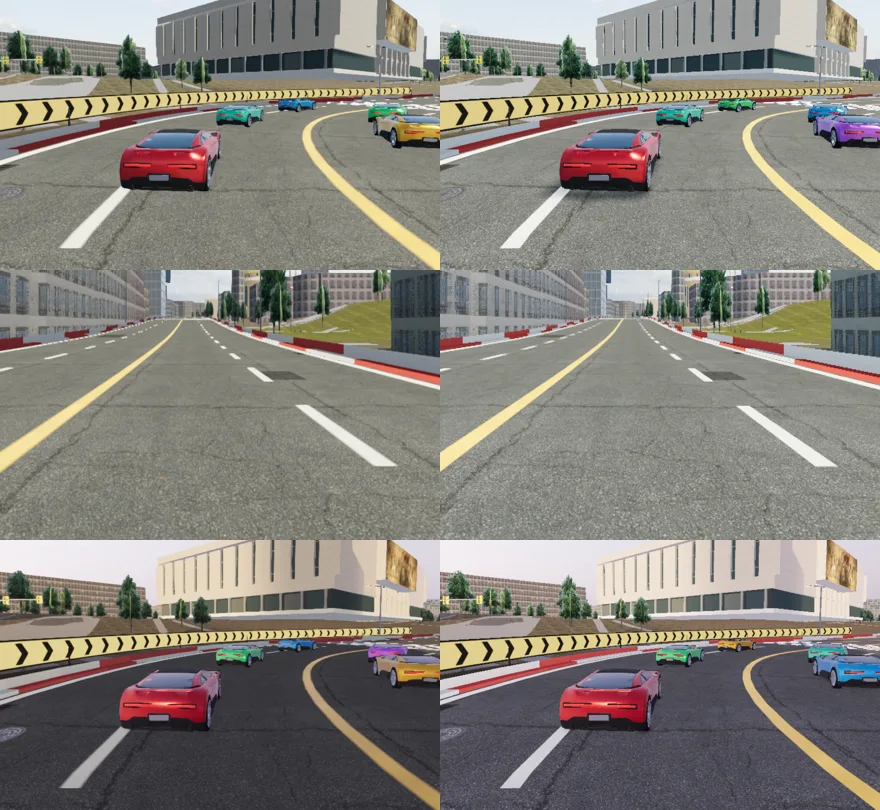

# Android graphics pass: sharpness, lighting, cost

Goal: a sharper, better-lit phone image on Godot's Mobile renderer at a 60 FPS
target, without Forward+-only features and without touching physics or
gameplay. Phones auto-detect to **medium**, so medium got most of the work.



*Left before, right after; medium, Mobile renderer, 1280×720. Rows: daylight
chase view, distant road, golden hour. Bot paint differs because the grid
colours come from the race seed.*

## Changes

| Area | Before | After | Where |
|---|---|---|---|
| Medium 3D scale | 0.80, bilinear | **0.90**, bilinear | `Quality.PRESETS` |
| Medium anti-aliasing | FXAA | **MSAA 2×**, FXAA off | `Quality.PRESETS` |
| Texture mip bias | 0 everywhere | **−0.35** medium, −0.2 low, 0 high | `Quality.apply_viewport` |
| Pressure stage ≥ 2 | MSAA off, FXAA on | same, and mip bias eased to ≥ −0.2 | `Quality._derive_budget` |
| Cut-out foliage | alpha scissor | + **alpha-to-coverage** (edges resolve under MSAA) | `props.gd`, `pine_forest_multimesh.gd` |
| Road lines | fixed-width `smoothstep`, hard `step()` dashes | edges and dash ends **filtered over the pixel footprint** (`fwidth`); sub-pixel lines fade instead of crawling | `road.gdshader` (`line_mask`) |
| Crossings in the road shader | loop over 24 per pixel | **one texel fetch** from an R8 lookup (8 m per cell) | `road.gdshader`, `RoadMesh.crossing_lookup` |
| Car sun shadows | high only | high all cars; **medium the player's car** (stage < 2) | `Quality.p.player_shadow`, `CarVisual` |
| Contact shadow under cars | alpha 0.22 / tyres 0.34 | 0.42 / 0.58 (free: already drawn) | `car_contact.gdshader` |
| Daylight ambient | flat colour | **55% sky radiance** + colour (directional, bluish shade); dark presets keep the flat fill | `SkyEnv.apply`, `SKY_AMBIENT` |
| Daylight sun / exposure | sun × 0.75, preset exposure | sun × 0.81, exposure × 0.96 | `SkyEnv.DAY_SUN`, `DAY_EXPOSURE` |
| Glow | always on | **skipped below 0.15 intensity** (daylight 0.11, overcast 0.07) | `SkyEnv._gate_glow` |
| Weather transition sky | radiance re-filtered every frame | `Sky.PROCESS_MODE_INCREMENTAL` while blending | `SkyEnv.transition_to` |
| PROFILE report | — | adds `msaa`, `fxaa`, `mip_bias`, `player_shadow`, `car_shadows` | `Quality.snapshot` |

Unchanged: Low and High presets (apart from the mip bias), the automatic
adaptation (`PerformanceGovernor` stages, the 0.6 scale floor), the Mobile
renderer on Android, ACES tonemapping, night/rain/snow lighting, shadows'
atlas sizes and cascades, physics and gameplay.

## Why these, and what was rejected

- **FSR 1.0 is not an option on phones.** Godot 4.4 prints "FSR1 is only
  available when using the Forward+ renderer"; the Mobile renderer upscales
  bilinearly. Sharpness therefore comes from more pixels (0.9), MSAA instead of
  FXAA (FXAA smears road markings and texture grain) and a negative mip bias
  (the reduced scale otherwise picks blurrier mips).
- **Variants measured on medium (daylight chase view, sharpness of the road
  area, higher is sharper):** 0.80+FXAA 56 · 0.90+FXAA 68 · 0.90+MSAA 2× 95 ·
  **0.90+MSAA 2×+bias −0.35 111** · 0.85+MSAA 2×+bias 101.
- **AgX tonemapping (new in 4.4) rejected:** it flattened the frame into haze
  (road sharpness score halved from contrast loss alone).
- **More contrast/saturation rejected:** contrast 1.04–1.06 clipped the golden
  sky (0.3% → 2.7% of the frame); saturation 1.04 clipped the yellow centre
  line's red channel. Both stay at 1.02 / 0.98.
- **All cars casting on medium rejected:** the car is 41 003 triangles; six in
  the shadow pass would add ~246k triangles. Only the player's car (in focus,
  one extra draw) casts; bots keep the stronger contact shadow.
- **Glow** forces extra downsample passes and, on the Mobile renderer, the
  non-subpass post-process path ("Glow is not supported when using
  subpasses"). At daylight's 0.11 intensity it was invisible; it now only
  runs for golden, sunset, dusk, night, rain and snow.

## Validation (this machine: no GPU, lavapipe software Vulkan)

**Image comparison** — `tests/render_compare.tscn` (fixed cameras, race not
stepped) on the Mobile renderer, 1280×720, metrics from
`tools/render_metrics.py`:

| Shot (medium) | Road sharpness | Mean luma | Mean saturation | Clipped % |
|---|---|---|---|---|
| Day, chase | 56 → **119** | 0.60 → 0.63 | 0.14 → 0.12 | 0.02 → 0.03 |
| Day, distant road | 46 → **90** | 0.58 → 0.61 | 0.11 → 0.10 | 0.00 → 0.00 |
| Day, car | 53 → **93** | 0.47 → 0.50 | 0.20 → 0.20 | 0.10 → 0.11 |
| Golden, chase | 32 → **93** | 0.50 → 0.55 | 0.13 → 0.14 | 0.05 → 0.07 |
| Golden, distant road | 31 → **76** | 0.50 → 0.55 | 0.13 → 0.12 | 0.14 → 0.30 |
| Night, chase | 20 → **36** | 0.31 → 0.31 | 0.32 → 0.32 | 0.36 → 0.40 |
| Rain, chase | 17 → **28** | 0.27 → 0.27 | 0.25 → 0.25 | 0.26 → 0.28 |

High also sharpens slightly (road lines, mip-neutral): day chase 289 → 319.
Night and rain lighting is identical by design; only sharpness changes.

**Benchmark** — `--scene=race --auto --seed=7 --benchmark=20`, Mobile
renderer, 1280×720, adaptive quality off, daylight Tirana:

| Run | Medium mean frame | Medium p95 | High mean frame |
|---|---|---|---|
| Before | 320.7 ms | 371.9 ms | 651.3 ms |
| After | 365.0 ms (+13.8%) | 581.4 ms | 689.8 ms (+5.9%) |
| After code, old medium AA (0.8 + FXAA) | 326.4 ms (+1.8%) | 373.8 ms | — |

Reading: at the old resolution the new code costs about the same as before
(the player shadow and sky fill roughly offset the glow and crossing
savings). The medium increase is the sharper image itself: 27% more pixels
plus MSAA, and MSAA is expensive on a CPU rasteriser where tile GPUs resolve
it on-chip. The p95 rows rest on ~60 frames at ~3 FPS, so a few shader-compile
hitches dominate them.

**Tests**: full `tools/run_tests.py` (including the new `tests/render_quality`
on Mobile and Forward+) and the rendered `tests/graphics_visual.tscn` on both
renderers pass. `graphics_visual` had stopped running (it set the removed
`ChaseCam.cabin`); it now selects `ChaseCam.View.CHASE`.

## Not verified — needs the target phones

- **No Android frame times were measured.** Software Vulkan cannot say
  whether medium holds 16.7 ms on the A56. Before shipping, profile A56
  medium, S25 FE medium and S25 Ultra high with
  `python3 tools/export_android.py --version-code <n> --profile-seconds 60 --quality medium`
  (`<n>`: any version code above the installed build) and compare
  `frame.p95_ms` / `gpu_time` against a build of the previous commit.
- **MSAA 2× being cheap is an expectation for tile-based GPUs (Adreno, Mali,
  Xclipse), not a measurement.** If medium misses budget, the governor already
  falls back (stage 1: scale 0.81; stage 2: FXAA instead of MSAA, no player
  shadow). If the A56 lives at stage 2, lower medium's scale to 0.85 rather
  than reverting MSAA.
- **Glow savings and the subpass path** follow from Godot's renderer design;
  their size on phones is unmeasured.
- Rendered colours come from lavapipe; check daylight exposure on a phone
  screen in sunlight.

## Reproduce

```sh
# captures (needs Vulkan or lavapipe; SHOTS must be an absolute directory)
SHOTS=/tmp/shots godot --path godot --rendering-method mobile --resolution 1280x720 \
    res://tests/render_compare.tscn -- --env=day      # also golden, rain, night
python3 tools/render_metrics.py /tmp/shots
```
