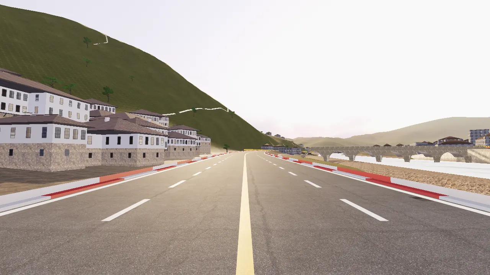
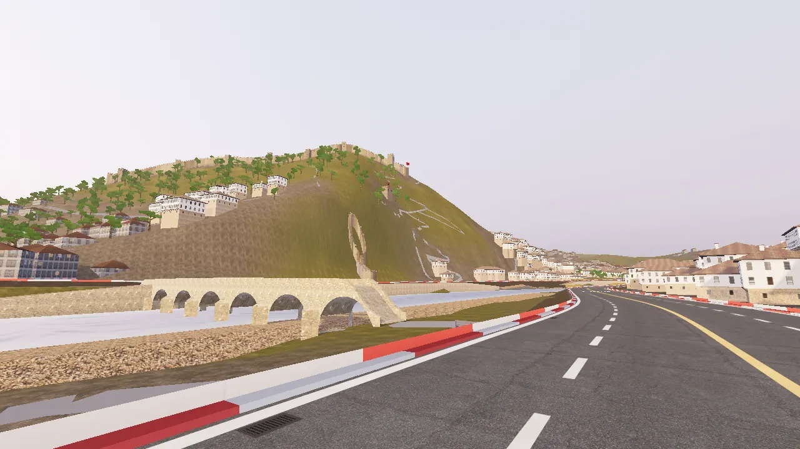
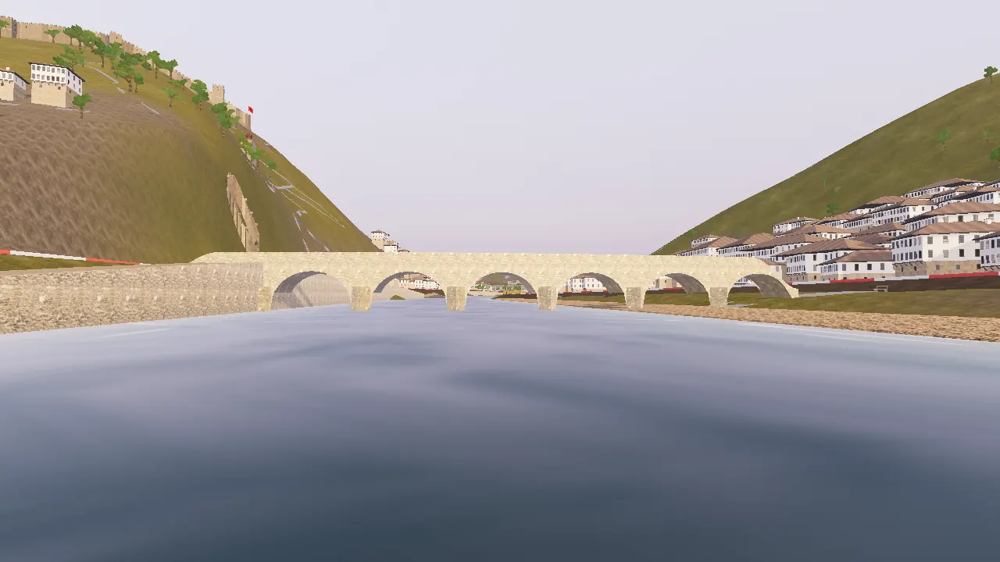
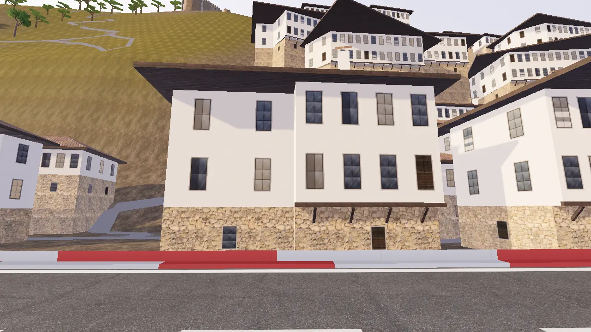
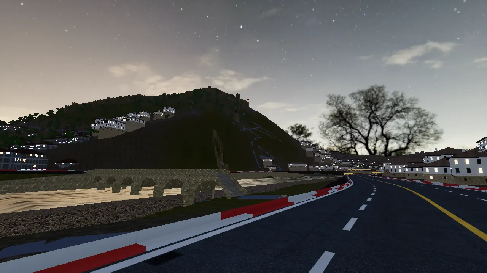
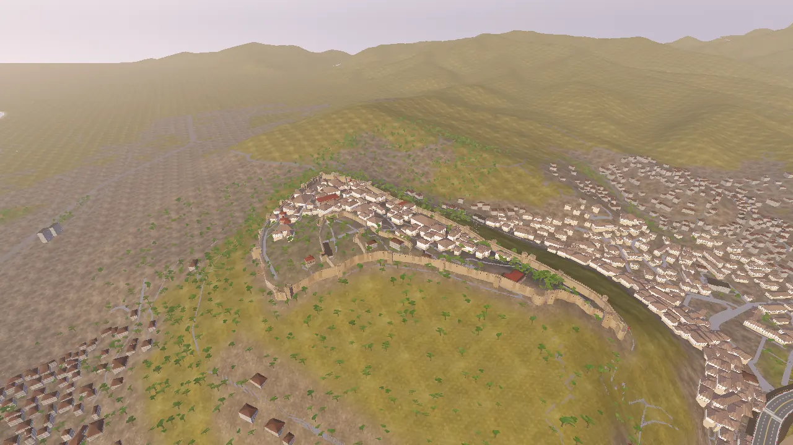

# Berat: the Osum, the houses of a thousand windows and the castle

Berat is an 8.9 km lap with the Osum alongside it the whole way, built from OpenStreetMap streets and Copernicus elevation (`python3 tools/pipeline/build_all.py berat`). Three pipeline stages bake what OSM maps only as lines and footprints: the river (`river.py`), the houses of the old quarters (`old_quarters.py`) and the castle (`berat_castle.py`). The game builds them as `CityRiver`, `OldQuarter` and `BeratCastle`.



## The lap

The race starts on the Gorica road, 120 m before the Gorica bridge, heading west. Gorica's houses stand on the left, and Mangalem and the castle rise across the river on the right. The lap runs under Gorica along Rruga Shpiragu and crosses the Osum on the SH74 bridge. It comes back east on Rruga Antipatrea beneath Mangalem, then follows Rruga Shëtitorja Osumi south-east to Ura e Bilçës. It crosses there and returns north-west on the left bank's riverside road to Gorica. Both crossings are bridges. The road keeps 2–10 m above the water, and the lap stays between 50 and 77 m. Berat opens at twelve cup stars. Its default light is the golden afternoon, which falls on Mangalem's south-facing windows.



## The Osum

OSM maps the Osum as a centreline, so `river.py` derives the rest:

- **The water level.** The level is the lowest ground across the channel, and it never rises downstream. It is held at least 2.6 m below a riverside road, about 70 m down to 37 m across the 11.7 km of river on the terrain.
- **The width.** The river is 46 m wide. It narrows on a side where the road runs beside it, and that side becomes a stone retaining wall up to a paved riverside walk. It stays full width where the race crosses on a bridge.
- **The riverbed.** The terrain is lowered under the channel after the road conform. Terrain chunks the river crosses keep their full 15 m detail at any distance, so no coarse level of detail fills the channel.
- **Riverside roads.** The surface model reads the houses and trees beside a riverside road as ground. Those roads are capped about 5 m above the water and lifted to deck height over the river.
- **Bridges and footbridges.** The two race bridges and the mapped footbridges are recorded.

`CityRiver` draws the water as a ribbon that is green-teal mid-channel and silt-green over the gravel. Its ripples run with the current (`shaders/river.gdshader`). It also builds:

- gravel banks of CC0 river pebbles,
- the embankment walls and walk,
- concrete decks, parapets with steel rails and current-aligned piers for the race bridges,
- **Ura e Goricës** as an Ottoman stone bridge of seven arches on piers with pointed cutwaters, a paved deck and low parapets,
- the light suspension footbridge below Mangalem.



## The houses of a thousand windows

Every mapped house inside the Mangalem, Gorica and castle (Kala) quarters, 460 in all, is built on its own footprint at its own ground height. Up the slope they stand one above the other, as they do in Berat:

- **Stone ground floor.** Rubble limestone (CC0 Stone Wall) reaches down to the lowest ground, so downhill sides show a tall stone base, capped at 6 m above a road cut. Small shuttered windows are set in it.
- **Upper floors.** One or two whitewashed upper floors (CC0 White Stucco) sit above. On most houses the valley-side floor juts out over a dark timber beam on brackets.
- **Windows.** Close rows of tall windows face the valley, about 1.25 m apart, with fewer on the other sides: 16,700 windows in all. Each is a quad from the Berat window atlas, baked by `tools/build_berat_windows.py` from CC0 Dark Wooden Planks. There are four variants: six panes, four tall panes with one leaf ajar, a white curtain behind the lower panes, and closed boards. The glass takes the sky by day. At night a warm light comes on behind about half of them (`shaders/old_window.gdshader`).
- **Roofs.** Each house has a low hipped roof of weathered tiles (CC0 Roof 09) on 0.8 m eaves, with dark timber fascias and soffits, ridge tiles and, on half the houses, a whitewashed chimney.

The houses are merged into 300 m blocks with five materials each: stone, plaster, roof, timber and windows. These footprints are left out of the generic buildings, and religious buildings and ruins are left to the castle.





## The castle

`berat_castle.py` bakes Kalaja e Beratit from its mapped walls. `BeratCastle` builds it with Rozafa's wall and tower kit:

- **The curtain wall.** The 1.6 km curtain wall rings the hilltop on a battered talus, in grey limestone with a crenellated parapet and arrow slits, following the ground.
- **Inner walls.** Ten more runs of wall cover the inner citadel, the cross walls and the wall down toward Mangalem.
- **Towers.** Thirty-one flanking towers stand at the wall's turns, at most 68 m apart, square or round.
- **The gate.** The mapped gate has arched portals.
- **Churches and ruins.** The Kala quarter's Byzantine churches are in stone banded with brick under tiled roofs, and the domed ones carry a drum of arched windows and a dome. St Michael's stands on the cliff above the river. The Red and White mosques are roofless ruins, and the Red Mosque keeps its minaret stump.
- **The flag.** The Albanian flag flies over the southern spur above Mangalem.

The castle hill and the slope above Gorica are wooded (`woods` in `cities.py`). Trees stand on open ground and never on a house, the walls or the road. The castle draws to 4.2 km, so it stays in sight from most of the lap.



## Checks and captures

`godot/tests/city_worlds.gd` loads Berat through the production race scene. It checks:

- the lap length and the river's water,
- both race bridges, the footbridges and Gorica's arches, and the embankments,
- that the road stays above the water,
- the houses and their windows, and that no house stands on the road,
- the castle's towers, inner walls, churches, domes and flag, its draw distance and its height over the river road.

`tools/pipeline/test_river.py` covers the river bake and the quarter houses on synthetic data.

Render the review views (Vulkan; lavapipe works):

```sh
SHOTS=$PWD godot --path godot --rendering-method mobile --resolution 1280x720 res://tests/berat_visual.tscn
```

`VIEWS=grid,mangalem` limits the run, and `ENV=night` shows the windows lit.

Data © OpenStreetMap contributors (ODbL); elevation © Copernicus DEM. Texture credits are in `godot/assets/CREDITS.txt`.
