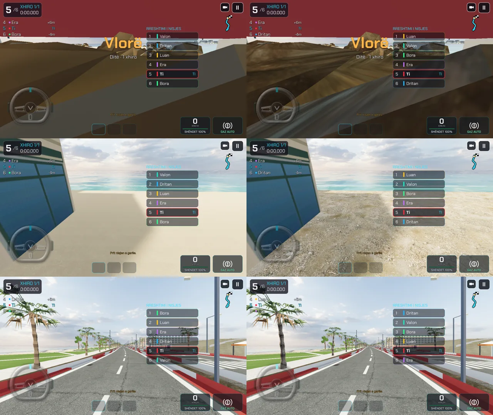
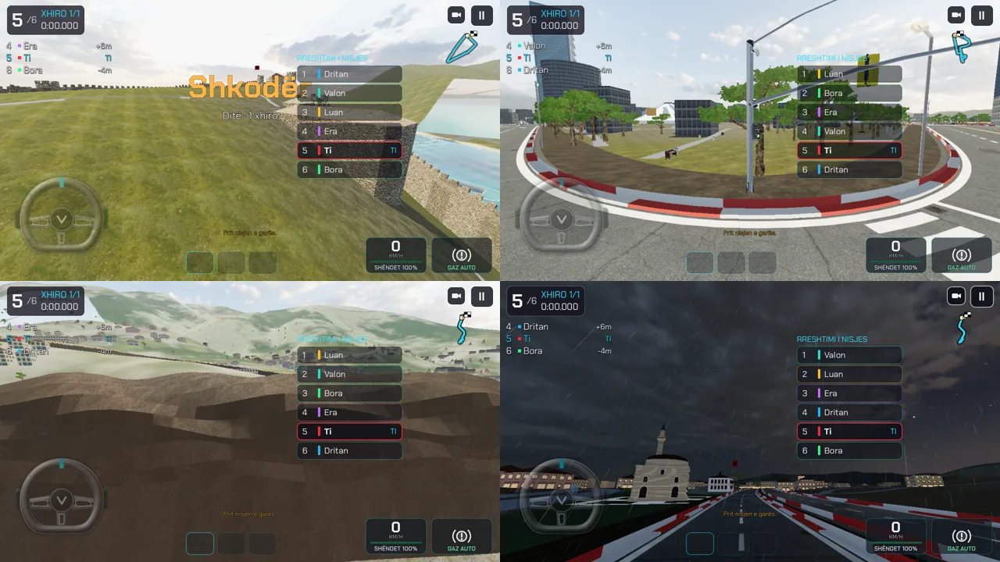

# CC0 surfaces and props

Fetched by `tools/fetch_cc0_assets.py` (Poly Haven, ambientCG; provenance in
`tools/cc0_assets.lock.json`). Rendered with `tests/cc0_assets_visual.tscn`
on the Mobile renderer (lavapipe software Vulkan); phone cost is unmeasured.

| Surface | Asset | Where |
|---|---|---|
| Vlorë beach | Coast Sand 04 (diff, nor, ARM) | `terrain.gdshader` sand band; tone kept by `sand_color` |
| Sea armour, tunnel portal | Rock Face 03 | `sea_rock.gdshader` (triplanar), `vlore_tunnel.gd` |
| Lungomare paving | Precast Stone Paving | `seafront_ground.gdshader` replaces the hash slabs |
| Palm trunks | Palm Tree Bark | `palm_trunk.gdshader` (object-space triplanar) |
| Rozafa masonry | Castle Wall Slates | `rozafa_castle.gd` |
| Street furniture metal | ambientCG Metal032 | `street_furniture.gdshader` (grain and relief only) |
| Road roughness | Asphalt 02 ARM (G) | `road.gdshader`; `asphalt_rough.jpg` removed |
| Night rain sky | Kloppenheim 07 Pure Sky | `SkyEnv.HDRI["rain"]`, energy 0.18 |

Detail photographs are divided by their mean colour, so the tuned vertex
colours and uniforms keep each surface's tone; low quality skips the
triplanar detail.

Not in the game yet: `stucco` and `shutter` (the shopfronts they are for are
not built), and the reduced props in `assets/props/*/<key>_mobile.res`
(`tools/build_cc0_props.gd`). The bin is a 1.8 m skip, not the litter bins OSM
maps; the lamp and utility box have no placement data; the bench read as a
farmhouse box beside the procedural street bench. The export excludes these
folders until they are placed.

