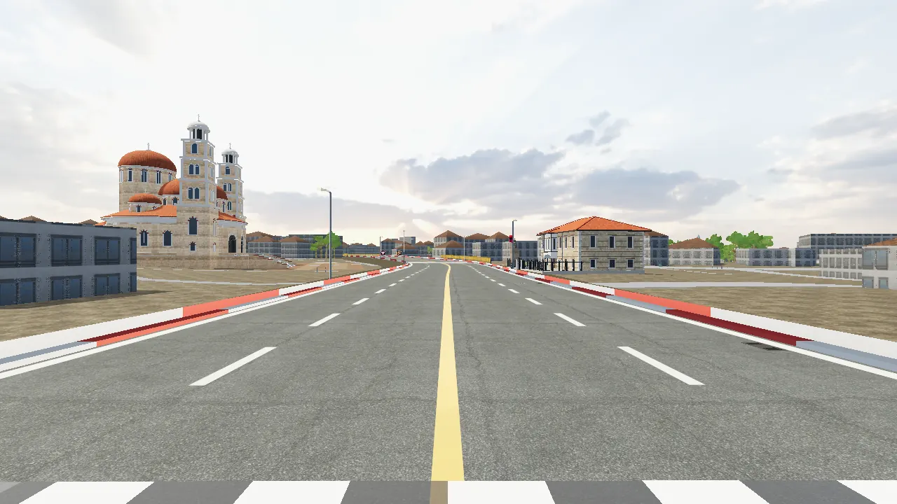
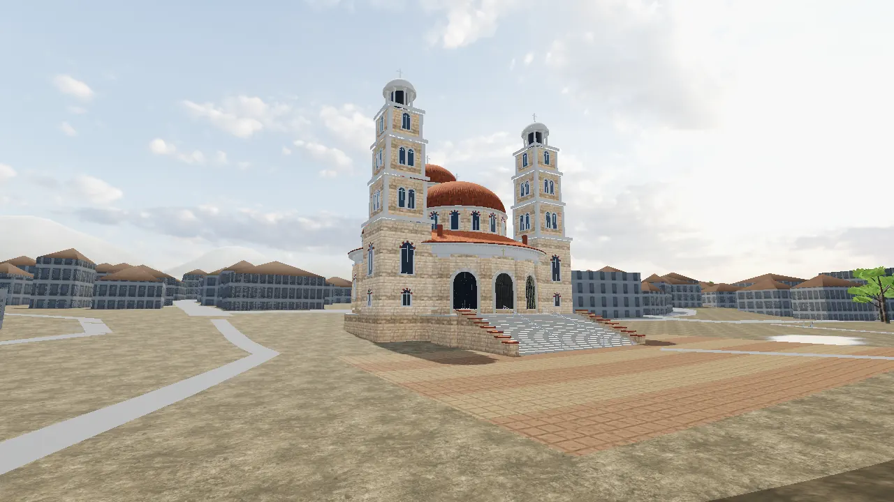
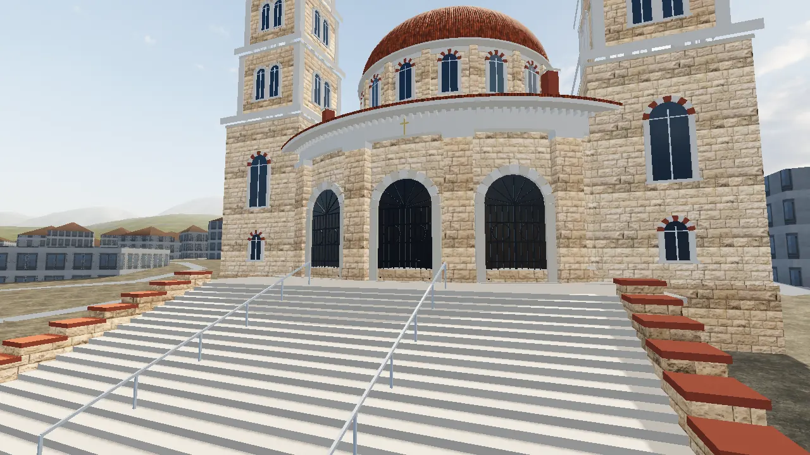
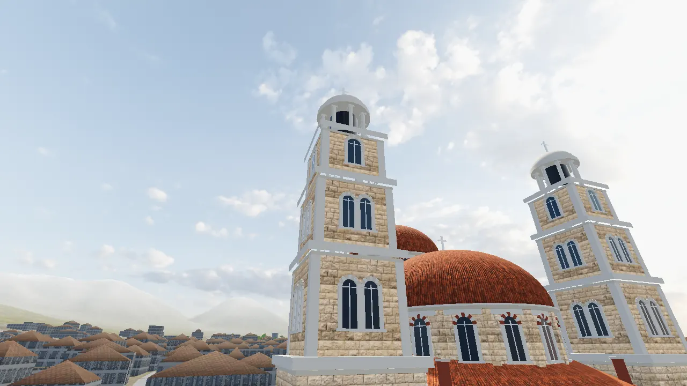
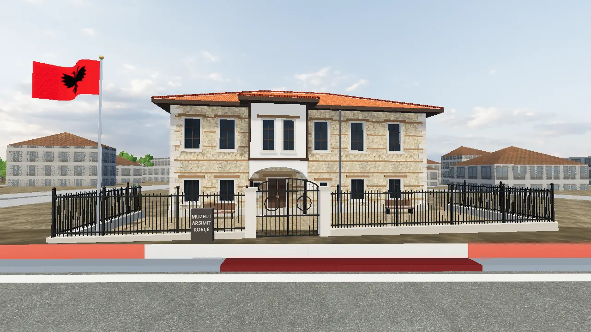
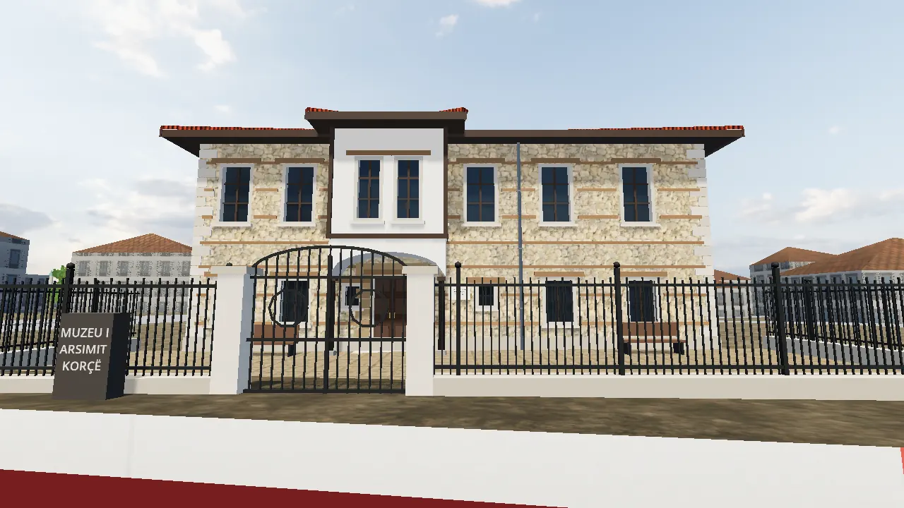

# Korçë: the cathedral, Mësonjëtorja and the loop

Korçë is a 3.1 km loop through the centre, built like Shkodër from OpenStreetMap streets and Copernicus elevation (`python3 tools/pipeline/build_all.py korce`). Its two set pieces, the Resurrection Cathedral and Mësonjëtorja, are original models after photographs, placed on their mapped outlines and built in GDScript like Rozafa and Kuzum Baba.



## The loop

The race starts on Bulevardi Republika, 100 m before the cathedral square, heading south-west. It passes Mësonjëtorja on the right and the cathedral across its square on the left, then rounds the roundabout onto Bulevardi Fan Noli. From there it runs north-west past the Old Bazaar and through Rruga Edit Durham and Sheshi i Teatrit, by the Andon Zako Çajupi theatre. It climbs Rruga Midhi Kostani, takes a short stretch of Rruga Teli Samsuri and returns by Rruga 1 Maji and Rruga Raqi Qirinxhi, a street of villas, to Republika. The race road is 18 m wide. The lap rises and falls between 847 and 873 m.

Korçë opens at ten cup stars, after Shkodër. Its default weather is day, and it uses the shared three-LOD street trees and old-town building palette.

## Katedralja Ngjallja e Krishtit



`KorceCathedral` (`godot/scripts/world/korce_cathedral.gd`) stands on OSM way 1165161082. Its curved portico and bell towers face west-north-west across the square to the boulevard, matching the outline.

- **Podium and steps.** A stone platform carries the church. A broad flight of fifteen steps runs down to the square between ashlar cheek walls with brick coping, divided into three by two steel handrails.
- **The round church.** The walls are coursed cream ashlar between banded piers with white capitals. The curved portico has three arched doors under stone voussoirs, each with an iron grille over two glass leaves and a ringed fanlight. Tall arched windows ring the sides, each with a white surround and an arch of alternating red brick and white stone. A white frieze, a dentil course and a cornice carry a conical clay-tile roof. Two brick chimneys rise from its front slope.
- **Domes.** The broad front dome sits on a drum of sixteen arched windows. The main dome stands higher behind it on a tall drum of twelve windows. Two small side domes and the apse have their own drums and tiled roofs. A white cross tops each dome.
- **Bell towers.** Each tower is about 34 m to the cross. It rises from a tall stone base with brick-arched windows through three set-back stages with white cornices, quoin pilasters and paired arched windows. An open round belfry of eight columns, a white cupola and a cross complete it.
- **The square.** Bands of buff and rose paving run from the steps toward the boulevard. Across the road stands Luftëtari Kombëtar (Odhise Paskali, 1932), a bronze warrior with his rifle on a stepped limestone pedestal.



### Surfaces

The cathedral uses three CC0 Poly Haven surface sets, each with colour, OpenGL normal and roughness maps:

| Surface | Texture | Where |
| --- | --- | --- |
| Coursed ashlar | Sandstone Blocks 05 (`ashlar_buff_*`) | walls, piers, drums, towers, podium |
| White stone and render | White Stucco (`stucco_*`) | frieze, cornices, quoins, window surrounds, belfry, cupolas, steps |
| Clay tiles | Clay Roof Tiles 02 (`clay_roof_*`) | conical roof, every dome, the apse |

`ArchKit` (`godot/scripts/world/arch_kit.gd`) gives every face UVs in metres laid out the way the material runs. Wall UVs keep the stone courses level, so they line up from pier to wall at the same height. Roof and dome UVs run down the slope from the crown, so rows of tiles run from the top of each dome to its eaves. Vertex colours tint the textures to the photographs: cream stone, white trim, red brick voussoirs and terracotta tiles.

### Draw budget

The cathedral is about 33 000 triangles. Five meshes are drawn to 2.8 km: ashlar, trim, tiles, glass and crosses. The carved trim (window and door surrounds, voussoirs, dentils) and the ironwork are drawn only within 650 m, where they read, and cast no shadows. Beyond that, the windows stay as dark arched glass in the stone.



## Mësonjëtorja



The first Albanian-language school opened on 7 March 1887 in the house Diamanti Tërpo gave it. It is now the National Museum of Education (OSM way 461159519). `KorceHeritage` (`godot/scripts/world/korce_heritage.gd`) builds it after photographs:

- **Walls.** Rubble limestone with pale pointing (Poly Haven Stone Wall) is laced with timber bands about every 0.95 m. The bands break round the openings. Dressed quoins alternate long and short at the corners above a plinth course.
- **Openings.** Upper windows have six panes in dark timber frames. Ground-floor windows are barred. Each opening has stone reveals, a timber lintel and a sill. The double door is panelled and set in a surround of brown dressed stone, with a marble plaque beside it: "Mësonjëtorja e Parë Shqipe, 7 Mars 1887".
- **The oriel.** A white plastered oriel over the door stands on two wooden posts. Its skirt is arched over the doorway, with two front windows and one on each side. A small hipped roof runs back into the main slope.
- **The roof.** A low hipped roof of clay tiles sits on deep eaves with dark fascia boards and soffits, with ridge and hip tiles.
- **The forecourt.** Stone paving and benches stand behind a black iron railing on a stone kerb. An arched double gate faces the door between stone piers. The museum's stone ("Muzeu i Arsimit Korçë") and the Albanian flag stand by the gate.



### Racing adaptations

The museum stands about 60 m from Republika, behind a café and its garden. To keep it in clear view from the race, the model moves 42 m through the garden toward the boulevard and turns its oriel front to the road. Its railing is then about 6 m from the kerb. The pipeline:

- removes the generic buildings whose roofs cross a driver's line of sight to either landmark (`sightlines`; 28 buildings on this lap),
- clears trees and generic buildings inside each landmark's footprint (`clear_half`), and
- writes the museum to `track.json` as an open view (`open_view` in `cities.py`, `views` in the track), so the chevron band on the outside of the bend is not drawn in front of it.

## Checks and captures

`godot/tests/city_worlds.gd` loads Korçë through the production race scene. It checks the lap length, the shared street trees, the cathedral's doors, domes, towers and windows, its textured materials and draw distance, the museum's windows, railing, plaque and flag, the distances from the race line and that no chevron band stands in front of the museum. `tools/pipeline/test_korce.py` covers the city configuration.

Render the review views (Vulkan; lavapipe works):

```sh
SHOTS=$PWD godot --path godot --rendering-method mobile --resolution 1280x720 res://tests/korce_landmarks_visual.tscn
```

`VIEWS=square,school` limits the run to the views whose names start with those prefixes. The scene also prints the landmarks' mesh and vertex counts.

Data © OpenStreetMap contributors (ODbL); elevation © Copernicus DEM. Texture credits are in `godot/assets/CREDITS.txt`.
