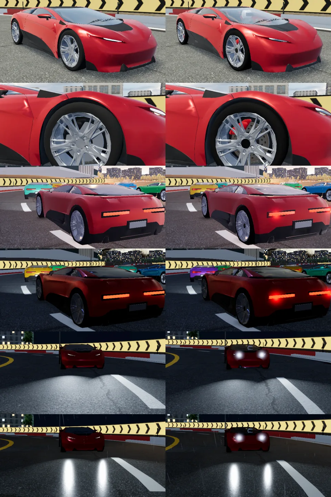

# Vehicle graphics pass

Goal: a premium mobile-racer look for the Vortex GT on the Mobile renderer,
without changing physics, dimensions, wheel positions, paint customisation
or the private-car path, and without new third-party assets.

*Left before, right after; medium, Mobile renderer. Rows: daylight
three-quarter, front wheel, braking at sunset, braking at night, headlights
at night, headlights in rain. Rival paint differs because grid colours come
from the race seed.*

## Asset constraint

The public car is a derivative of the Khronos "Car Concept" (CC BY 4.0).
`tools/import_carconcept.py` deliberately removed every original texture
(they carry trademarks, including on the tyre sidewalls), and its materials
are flat colours. There are therefore no licensed normal, roughness or
metallic maps to add. Every detail below is a shader working from the
mesh's own geometry (surface names and model-space position), or a few
procedural triangles. No image, model or texture was added, and the GLB is
unchanged.

## Changes

| Area | Before | After | Where |
|---|---|---|---|
| Paint | metallic 0.6, rough 0.25, clear coat 0.65 / rough 0.18 | metallic 0.55, base rough 0.38 under a **full, near-sharp clear coat** (1.0 / 0.06): crisp reflections over a satin flake coat, not a mirror; damage strips it to 0.1 | `CarVisual.PAINT_*` |
| Private atlas paint | same as above | same values, plus **metallic flop** (the base coat deepens toward grazing angles) | `sport_car.gdshader` |
| Glass | opaque dark blue | **tinted 55% with premultiplied alpha**: reflections at full strength, the cabin visible head-on | `CarVisual._mk_glass` |
| Interior | black (`0.07` sRGB) | charcoal, and **a low-poly driver in every car** (rivals wear their paint colour on the helmet) | `_make_finish_driver` |
| Brake calipers | modelled inside the wheel mesh, **spinning with it** | taken out at load (stripped wheel meshes are cached), one non-spinning mesh per car; front pair **steers** in the vertex shader | `_strip_caliper`, `car_caliper.gdshader` |
| Rims | flat shop colour | shop colour, with a **cross-drilled cast-iron disc** (lathe grooves, heat tint, hub hat), shaded barrel, diamond-cut lip, black centre cap; colour still from `Data.RIMS` | `car_rim.gdshader` |
| Tyres | flat black | tread with **three circumferential grooves**, sidewall band, darker and glossier **when wet**; no lettering (trademark stays removed) | `car_tyre.gdshader`, `CarVisual.set_wet` |
| Trim | flat black | satin plastic; **honeycomb mesh** in the front intakes; **clear-coated twill carbon** on splitter and diffuser | `car_trim.gdshader` |
| Headlights | flat emissive | clear lens over chrome, **DRL strip** by day, **projector eyes** lit at night; beam aimed 4° down (was 6°), 34° cone, softer edge | `car_lamp.gdshader`, `_make_headlights` |
| Tail lights | flat emissive | **LED segments**, brighter toward the ends; tail by day / night, brake 3.6× | `car_lamp.gdshader` |
| Lamp glow | screen glow only (skipped in daylight) | **halo sprites** at head and tail lamps that show only toward where each lamp points; brake halos by day too | `car_halo.gdshader`, `_make_halos` |
| Contact shadow | one soft blob, fixed tyre spots | soft occlusion plus a **dark contact patch and penumbra under each tyre**, at the model's own wheel positions | `car_contact.gdshader` |
| Reflection atlas (Mobile) | 128 px faces, 64 slots | **256 px faces, 12 slots** (a race uses at most 7, the garage 1): sharper paint reflections in less memory (≈ 50 MB vs ≈ 67 MB, RGBA16F with mipmaps) | `project.godot` |
| Probe renders | everything on the world layer | street furniture, pickups and effects on a **detail layer the probes skip** (cameras still draw them) | `RaceReflections.hide_detail` |

Tried and rejected: a dipped-beam **projector texture** on the headlight
spots. On the Mobile renderer a spot with a projector lights nothing at all
(verified in renders), so the beam is shaped with aim, cone and attenuation
instead.

## Cost

Per car (public model, medium):

| | Triangles | Draw calls by day | Draw calls at night |
|---|---|---|---|
| Player before | 51 677 | 27 | 27 |
| Player after | 41 513 | 24 | 28 |
| Rival before | 41 009 | 22 | 22 |
| Rival after | 41 513 | 24 | 28 |

The old player driver alone was ~10.7k triangles (64-segment capsules); the
new one is 504 and rides in every car. Wheels lose their caliper surface
(−4 draw calls), the calipers come back as one mesh (+1), drivers add 5 per
rival. At night the four halos add 4 per car (6 cars → +24). The transparent
glass covers a small part of the screen.

Benchmark (`--scene=race --auto --seed=7 --benchmark=20`, Mobile renderer,
1280×720, medium, adaptive off; software Vulkan):

| | Before | After |
|---|---|---|
| Daylight, mean frame | 272.2 ms | 265.9 ms (repeat: 266.1 ms) |
| Night, mean frame | 315.4 ms | 304.9 ms |

No measurable cost on this machine; the difference is within run-to-run
noise. **Not measured on phones**: the extra draw calls at night and the
transparent glass are the items to watch in a phone profile
(`tools/export_android.py --profile-seconds 60`).

## Validation

- Captures in daylight, sunset, night and rain, medium and high:
  `tests/render_compare.tscn -- --env=<day|sunset|night|rain>
  --views=car,car_rear,wheel,car_front`.
- New `tests/car_detail`: dimensions and wheel positions unchanged; calipers
  out of the wheels, inside each wheel, steering with the front wheels; shop
  rim colour on the wheel shader; paint colour from the car; glass
  premultiplied and tinted; drivers in every car; DRL / beam / brake states
  and halos; contact patches under the tyres; wet tyres; detail layer
  skipped by probes; atlas big enough.
- Updated: `car_paint_lights` (new paint constants, lamp shader energy),
  `readiness` (brake lamp shader, caliper checks, halos outside the triangle
  budget), `shop` (rim colour on the shader), `car_visual_regression` (halos
  never cast).
- Full `tools/run_tests.py` passes on Mobile and Forward+.

## Compatibility

- Paint colour, rims and liveries: unchanged paths (`mat_paint` is still a
  `StandardMaterial3D` with the livery as its next pass; rim colour and
  finish come from `Data.RIMS`).
- Private atlas car: keeps `sport_car.gdshader` (same finish values) and its
  lens boxes; the wheel, caliper, trim and lamp shaders apply only to
  surfaces named as in the public model, and halos fall back to the car's
  size when there are no lamp surfaces.
- Physics untouched; the caliper steer and lamp states read the visual
  state `CarVisual` already had.
