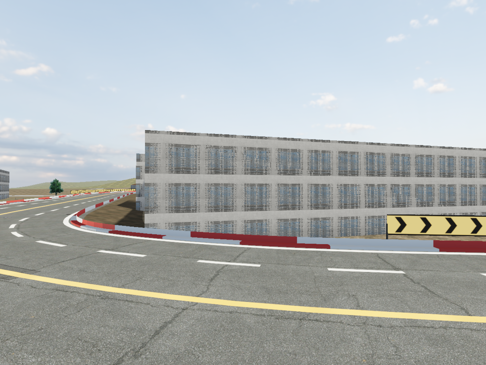
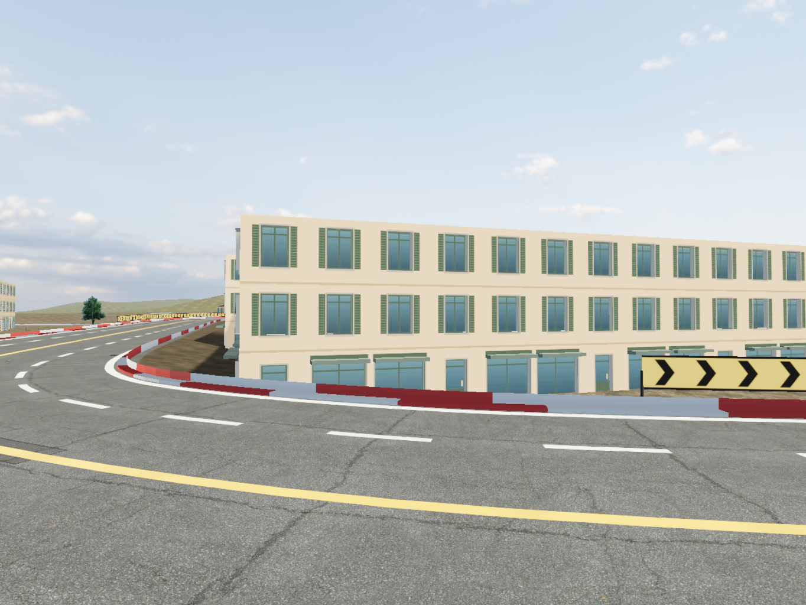
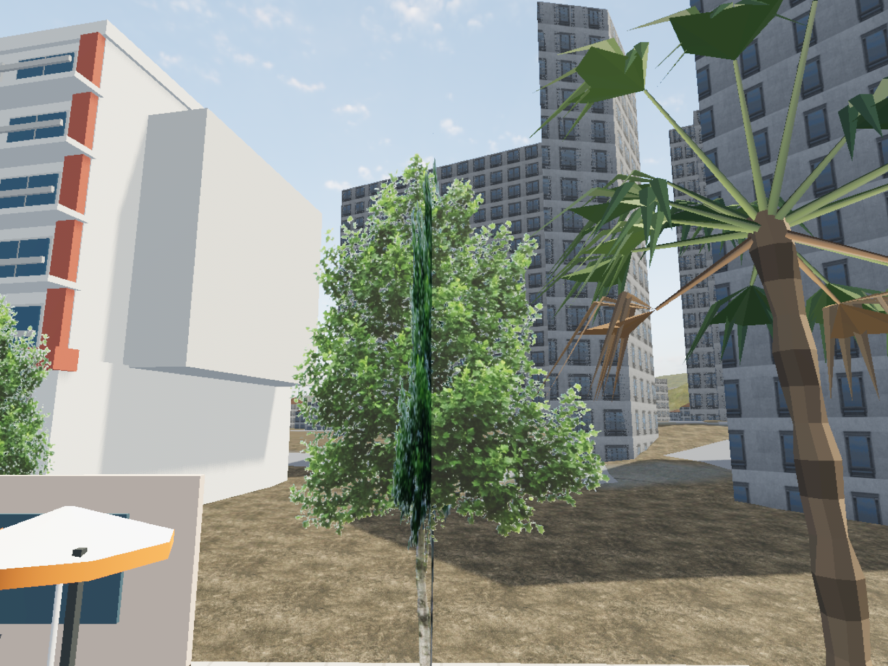
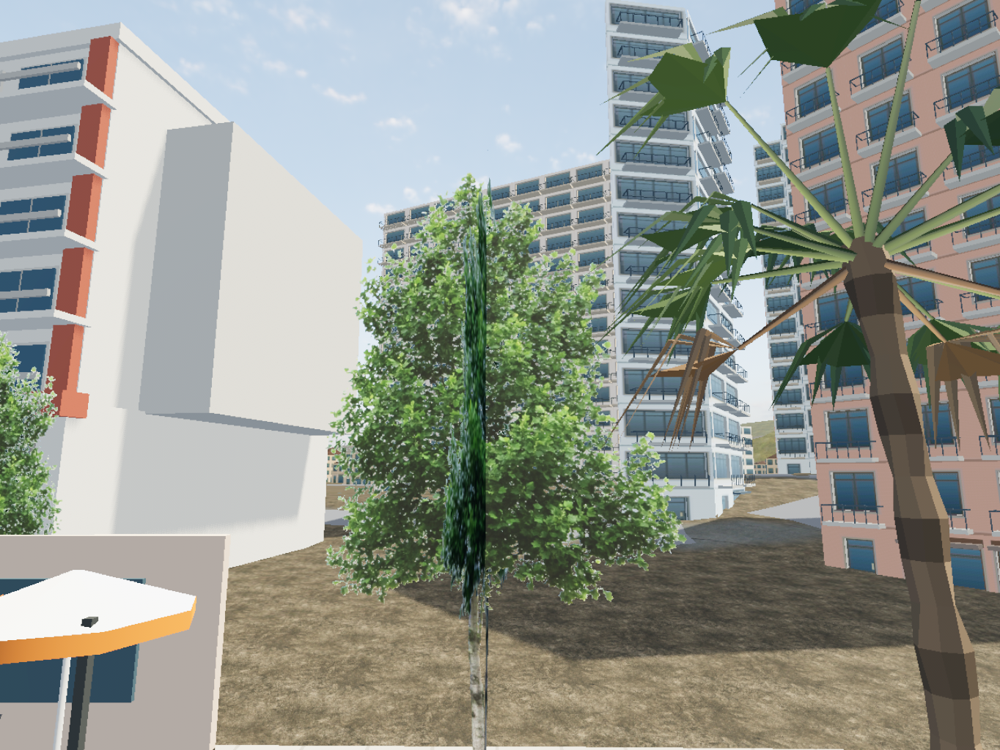

# Vlorë architecture

| View | Before | After |
| --- | --- | --- |
| Flag Square |  |  |
| Lungomare |  |  |

Both pairs use the production world, fixed cameras, daylight, Medium quality and a 1364 × 1024 viewport. The baseline is `2195961`. Captures used Godot 4.4.1 Mobile with Vulkan llvmpipe.

To reproduce the views, run the capture scene on a display of the same size. It saves both PNGs in `user://shots`.

```sh
godot --path godot --rendering-method mobile --audio-driver Dummy --fixed-fps 60 res://tests/vlore_architecture_visual.tscn
```

The city build fits whole bays and storeys to the OSM shells. To regenerate the Vlorë assets from the shipped extrusion and centreline, run `python tools/pipeline/vlore_facades.py`. The baker updates façade UVs and the style channel in place. Position and index buffers retain the original footprints, heights and rooflines.

Within 120 m of the race line, street-facing elevations receive instanced window reveals, storefronts, doors, and projecting balconies according to family. Roof units sit inside flat roof triangles. The shared atlas also covers the shells, keeping shop and window locations aligned as the relief fades from 96 to 126 m. The far tier merges each chunk's roofs and walls into one opaque surface with averaged material colours. It takes over between 460 and 540 m and fades out from 1,880 to 2,040 m.
