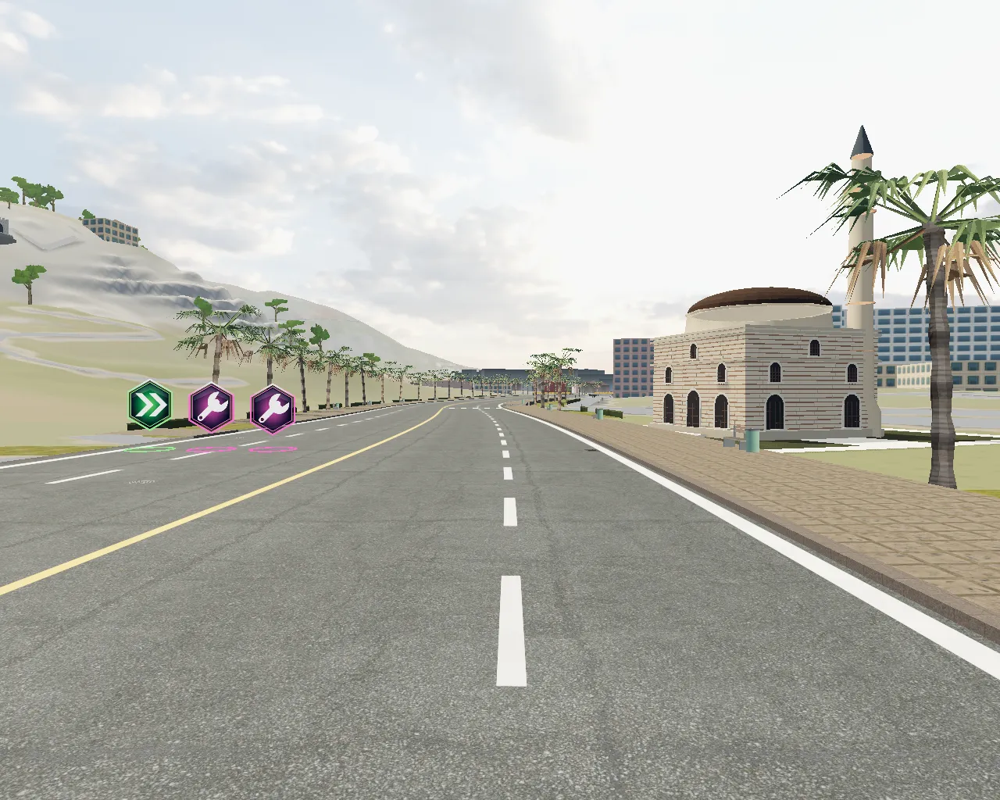
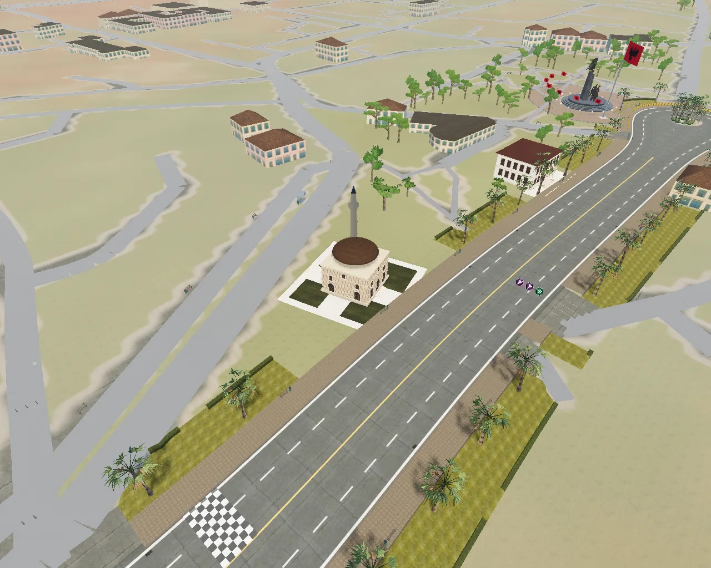
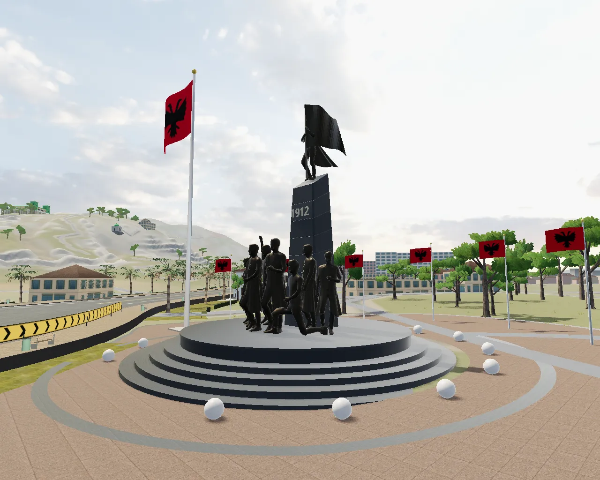

# Vlorë: the Muradie boulevard and Sheshi i Flamurit

From Sheshi i Flamurit south past the Muradie Mosque to Teatri Petro Marko, about 620 m on both carriageways, the lap runs as a city street instead of a circuit.



## The boulevard

`tools/pipeline/vlore_boulevard.py` reads the city's own outputs, with no OpenStreetMap fetch. It rasterises the side-road ribbons (`roads.glb`), the generic buildings (`buildings.glb`) and the landmark plots (`clear_half` in `cities.py`) into a 1 m grid. It writes that grid to `boulevard.json` together with the stretch's centreline (`'boulevard'` in `cities.py`).

`VloreBoulevard` builds the street from that grid, and `RoadMesh.street` drops the race kerbs, barriers and shoulder along the stretch. The street has:

- **Kerbs.** Granite kerbstones run along both outer edges (CC0 Granite Tile 03).
- **Sidewalks.** The paving (CC0 Promenade Paving) is 5 m wide and falls 2 % toward the kerb. It stops short where a building's wall stands nearer.
- **Junction mouths.** The side roads' ribbons end about 3.5 m from the race road. At each one the kerb is dropped and asphalt runs from the road's edge out to the ribbon.
- **The verge.** A planted strip of lawn lies behind the sidewalk, with a clipped hedge along its back, broken every 30 m for paths. It is left off side roads, buildings, the mosque garden and the monument square.
- **Palms and benches.** Palms are spaced every 15 m down the verge. Benches face the road every 30 m along the sidewalk's back edge, each with a bin beside it.

All of it is visual only: the cars keep the road's own boundary.



## Sheshi i Flamurit

The Independence Monument stands on four round steps and a polished drum of dark granite (CC0 Granite Tile), and its pylon is clad in the same stone. The bronze group, the flag-bearer and the cast flag take a weathered bronze finish with a dark brown patina, metallic enough to catch the sky.

In the race, `IndependenceMonument.build_square` paves the square round the monument in rose-grey granite (Granite Tile 03) out to 27 m. It has a darker inlaid ring and border, and it is cut back wherever the boulevard's sidewalk comes nearer. Fourteen white stone spheres ring the steps, leaving the front open, and seven Albanian flags fly on tall poles in an arc behind the monument. In the points arena the monument stands on its island without the square.



## Checks and captures

`godot/tests/city_worlds.gd` checks:

- the stretch's length on both passes,
- that the race kerbs return outside it,
- the kerbs, sidewalks, verge, palms, benches and junction mouths,
- the square's area, spheres and flags, and that the paving stays off the road.

Render the review views (Vulkan; lavapipe works):

```sh
SHOTS=$PWD godot --path godot --rendering-method mobile --resolution 1280x720 res://tests/vlore_square_visual.tscn
```

`VIEWS=monument,muradie` limits the run.
