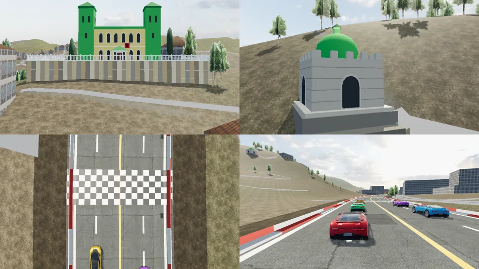

# Vlorë: Kuzum Baba and the start/finish line



## Kuzum Baba

The Bektashi hill above the boulevard (Kodra e Kuzum Babait, 88 m), built
as procedural interpretations after photographs at the OSM positions
(`scripts/world/kuzum_baba.gd`, one draw call each):

- **Temple** (`kuzum_baba_tekke`, OSM way 1222923149, 22 × 27.5 m, turned
  7.8°): a yellow two-storey hall with arched windows in white surrounds and
  a green cornice, between two 13 m green towers with dark pyramid roofs; a
  green-roofed pergola and an Albanian flag at the entrance; in front, a
  crazy-paved retaining wall under a white balustrade, following the slope;
  cypresses on the summit. Its facade faces west, down the hill.
- **Tomb** (`kuzum_baba_turbe`, OSM node 6436869917): grey coursed stone with
  crenellations and an arched opening on each face, under a drum, a green
  dome, a lantern and a finial, on a stone terrace stepped into the brow.

The mapped temple block is taken out of `buildings.glb` (it would sit inside
the model) and the trees inside both keepouts are cleared, as a full rebuild
does through `landmark_buildings` and `clear_half` in `cities.py`.

Where the race sees it: the tomb on the brow is abreast of the road 60 m
after the line and again on the way back; the temple, behind the brow from
the boulevard below, shows its towers above the rooftops.

## Start/finish

The line was first inside the square's turn (tightest radius ≈ 28 m within
40 m of it), then on Bulevardi Ismail Qemali 102 m before the park. Vlorë is
now a **sprint** ([the road and the sea](vlore-out-and-back.md#the-sprint)):

- **Start.** On the southbound carriageway by Sheshi i Flamurit.
- **Finish.** Beside the start on the northbound one, so the two chequers
  make one line across the road.
- **The run.** It passes the park out and back and does not turn at the
  square. The turn there lies past both lines and is never raced.

`tools/pipeline/finish_line.py` (`place_sprint`) rotates the closed lap to
start there and records both lines in `track.json` `"sprint"`:

```sh
python3 -c "import sys; sys.path.insert(0, 'tools/pipeline'); import finish_line; finish_line.process_sprint('vlore')"
python3 tools/pipeline/landmark_anchors.py vlore  # add new landmarks + keepouts
python3 tools/pipeline/glb_cut.py vlore 1222923149
```

All three only touch the processed data they name (track.json order,
props.json rows, the temple's index triangles in buildings.glb) and are
idempotent; `build_city.py` applies the same placement on a full rebuild.
Everything else in the city (tunnel, turnaround, crossings, furniture) is
located by world position, so it is unaffected.

Tests: `tests/vlore_kuzum_baba` checks:

- the start and the finish on the straight in both directions,
- that they sit side by side at the square,
- that the park is passed out and back,
- that the landmarks are built and face west, with no building
  inside the temple and no trees in the keepouts.

`tools/pipeline/test_finish_line.py` and `tests/city_worlds` cover the
sprint's order.
