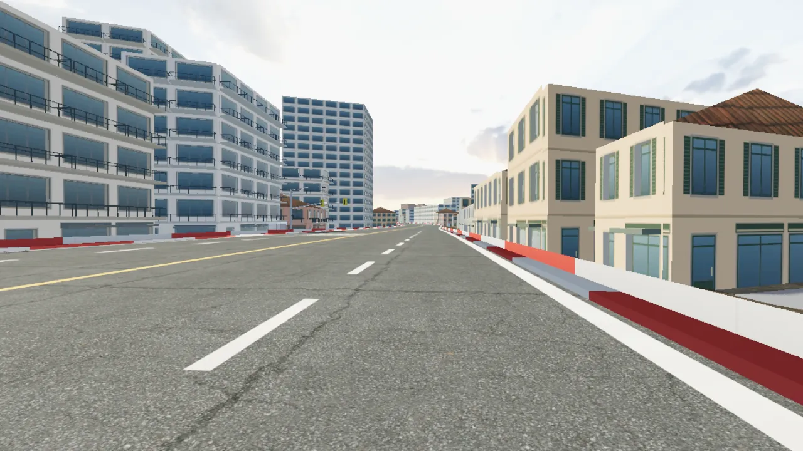
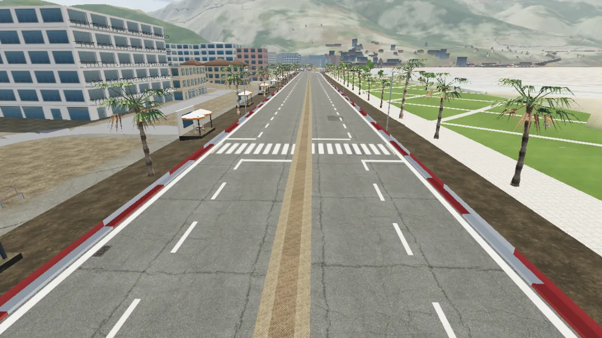
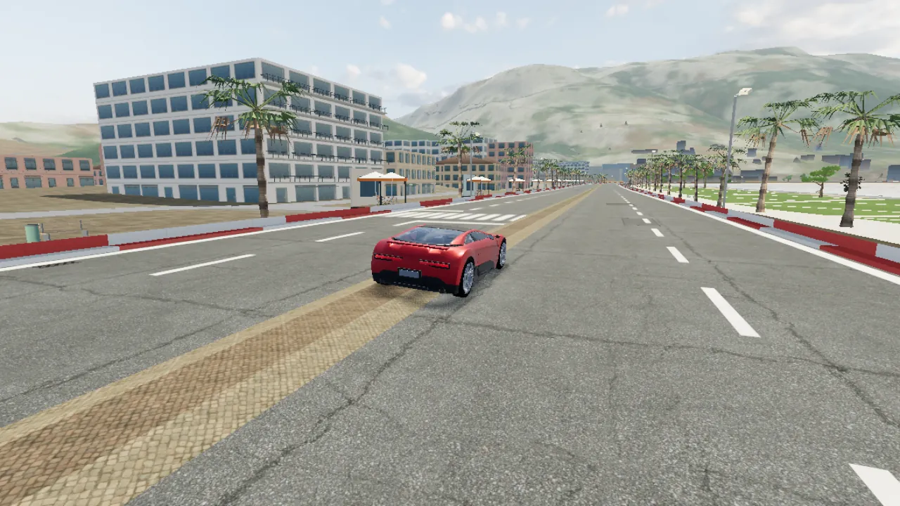
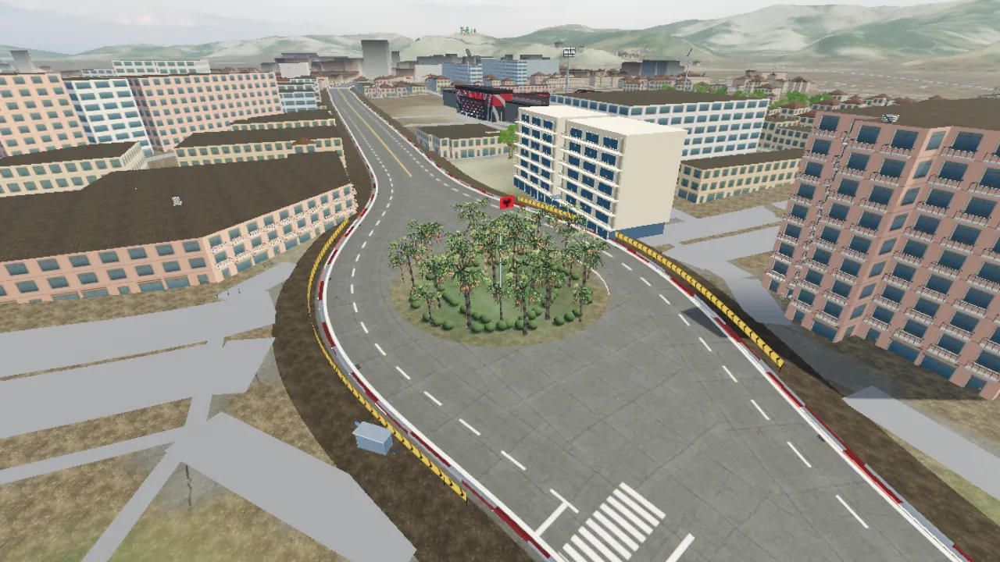
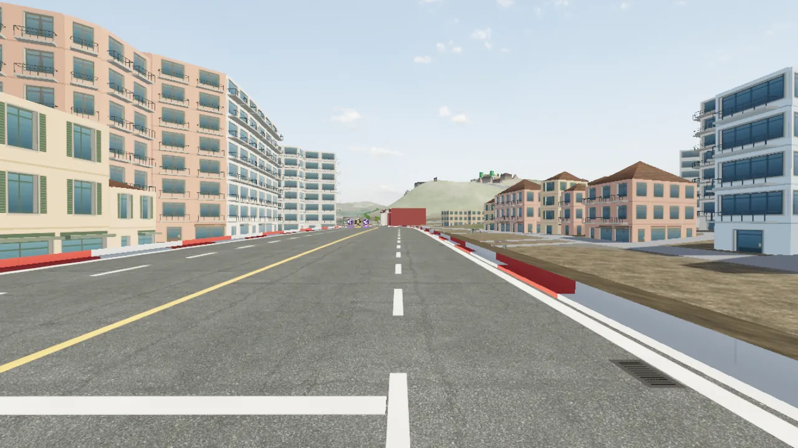
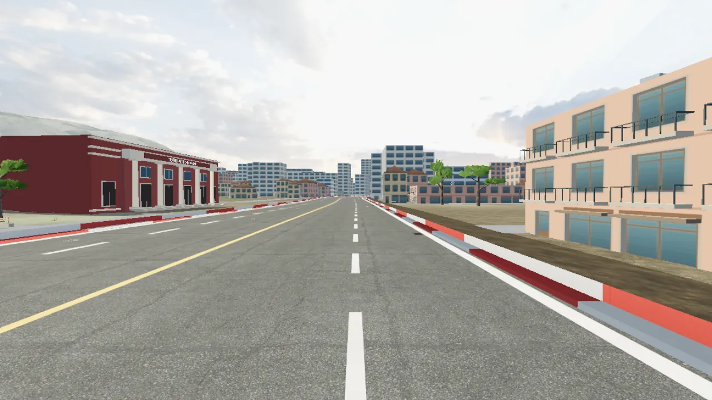
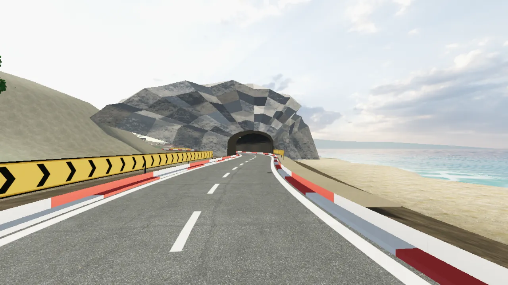
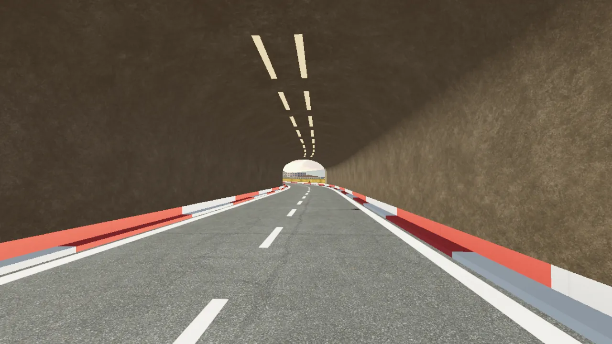
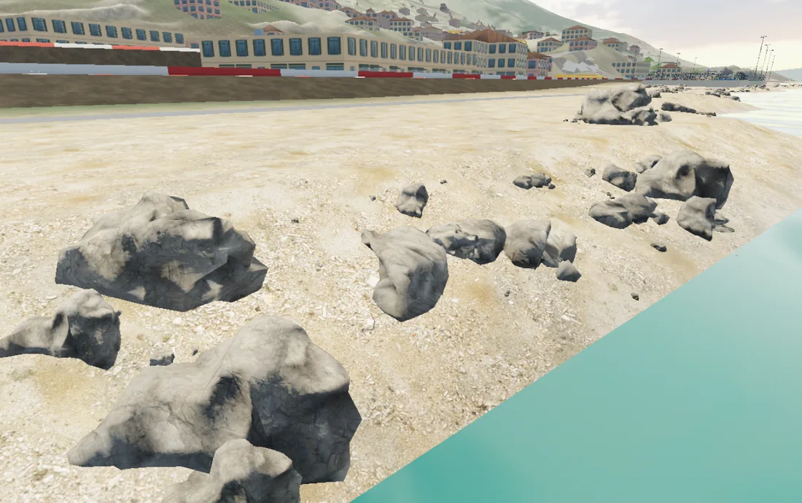

# Vlorë: the out-and-back road and the sea


## The circuit

Vlorë is now raced out and back on the seafront road, like the real
boulevard: **two one-way carriageways of two lanes, 9 m each, side by side as
one 21 m road** (centrelines 6 m either side of the mapped road; see
[One road](#one-road) below). Lap ≈ 9.5 km:

1. **Out** (right-hand carriageway, the sea side): from the line on
   Bulevardi Ismail Qemali, 100 m before Kuzum Baba, south past Petro Marko
   and Flamurtari stadium, **round the west side of the Sheshi Pavarsia
   island**, past the Independence Museum and down Lungomare and Rruga Murat
   Tërbaçi.
2. **Far loop** (one way): on past the waterfront sports courts and their
   rock-armoured shore, through the Uji i Ftohtë tunnel, the turnaround, and
   back north up **Dhimitër Konomi**.
3. **Merge**: Dhimitër Konomi joins the shore road's return carriageway on a
   40 m-radius bend (no hairpin; the outbound carriageway is ≥ 13 m away all
   through it).
4. **Back** (the land-side carriageway): north the same way, **round the
   east side of Sheshi Pavarsia**, past the stadium and Kuzum Baba, the
   Muradie Mosque, and **round the turning island on Sheshi i Flamurit** into
   the outbound carriageway and the line.

The old-town return (town hall, stone street, Muradie street, Lungomare
median) is gone from the lap: the road focus is the boulevard and seafront.

## How it is built (`tools/pipeline/build_city.py`, `cities.py` `out_and_back`)

- `shared` waypoints: the mapped road both legs use, Flag Square island →
  the merge point on Rruga Murat Tërbaçi (an OSM carriageway node, not the
  promenade footway beside it). Each leg is offset `offset` m to its side;
  near each roundabout in `roundabouts` the offset swells (cosine, over 2.4 ×
  the ring radius) so the legs go round the island.
- `loop` waypoints: an **open** path from the merge round the far end to the
  last stretch of Dhimitër Konomi. `_merge_join` cuts it short of the
  junction if it would come within a road width + 2.5 m of the outbound
  carriageway, then fits run-in, circular arc (either hand, widest radius
  ≤ 40 m that clears) and run-out into the return carriageway.
- `check_carriageways_apart` fails the build if, after bend smoothing, any two
  parts of the lap more than 50 m apart along it come within two half widths
  + 0.5 m: the passes never share tarmac.
- Roundabout islands (`'island': radius` on a landmark) are baked into
  `props.json` capped to the road as built (kerb 0.8 m off the road edge):
  Sheshi Pavarsia 18.1 m, Flag Square 7.3 m.
- `track.json` carries `lanes: 2` and `one_way: true`; the road shader then
  draws one dashed lane line and no yellow centre line (`RoadMesh.set_layout`).
- The finish (`finish_line.py`) and the seafront dressing (`seafront.py`) use
  the lap's **first** pass by their anchor, so the line stays on the
  outbound carriageway and the café terraces and land-side palms stand beyond
  the return carriageway.
- The simulation keeps working at half width 4.5 m: grid columns, pit/station
  lanes, respawn clamp and shock-dome lanes scale with it (`race.gd`;
  unchanged for the other cities).

Rebuild (Overpass mirrors refuse or time out from some networks;
`VORTEX_OSM_API=1` makes street furniture use the main OSM API):

```sh
python3 tools/pipeline/fetch_osm.py vlore     # falls back to the OSM API
VORTEX_OSM_API=1 python3 tools/pipeline/build_city.py vlore
```

## One road

Where the other pass of the lap runs alongside the opposite way, the two
carriageways are one road with nothing between them: no kerbs, barriers or
shoulders down the middle, asphalt across the old 3 m gap (it was a ditch:
the terrain there lies 0.5–1.5 m below the road), and a solid centre line.
On Lungomare a rounded median runs down the middle instead of the line.

- **Where** (`RaceTrack._join_build`, any track with `one_way`): a sample
  whose nearest sample of another pass (more than 60 m along the lap) is
  within 13 m and heads the opposite way within 25°. That is 6.1 km of the
  9.5 km lap, in five runs; they end where the passes split round Sheshi
  Pavarsia, at the turning island and at the Dhimitër Konomi merge.
  `JOIN` is the signed offset to the road's middle (6.0 m, on the driver's
  left; on the right in reverse), `PAIR` the alongside sample.
- **Level across**: the pipeline sampled each carriageway's elevation on
  its own, up to 0.75 m apart across the same street. Joined samples meet
  half way (eased over 50 m from each split), so the road is level within
  1 cm and a car on the far side sits on the tarmac.
- **Edges**: `EDGE_L` / `EDGE_R` are what the walls in `Race.physics` use.
  Joined, the reach on that side is the far edge of the other carriageway
  (16.5 m); it closes back to the carriageway's own edge over the 80 m
  before each split, so a car on the far side is eased back before the
  island nose. Bots keep to their own lanes.
- **Oncoming cars**: cars on opposite passes that meet on the shared road
  collide (`Race._contact_across`): momentum is exchanged in world space,
  and above 14 m/s closing speed both take damage.
- **Mesh** (`RoadMesh`): cross sections have seven vertices; on the joined
  side the surface runs to the middle and tucks 15 cm past it, 3 cm down,
  under the other pass's half. UV2 tells `road.gdshader` which side is
  joined: no edge line, gutter or gullies there, zebras run to the middle,
  each half paints its half of the centre line. The 110 baked lamps that
  stood in the old divider are dropped (`Props.in_joined_road`); corner
  chevrons on a joined side stand past the far edge, or are left out where
  the road is about to split.

### The Lungomare median

`track.json` `"median"`: entry and exit of the seafront stretch on the
outbound pass (`cities.py` `'median'`, written by `build_city.median_ends`);
the game flags the matching samples of the return pass too (912 m each way).

- **Profile** (`RaceTrack.median_lift`): 2 m across, a 0.9 m flat crown
  10 cm up, smoothstep shoulders down to the road; it eases in and out over
  6 m at its ends. The mesh (`RoadMesh.add_paved_median`, cobble top and
  concrete shoulders) uses the same profile the cars ride over.
- **Felt**: on its slopes the car loses up to ~2.5 m/s² of speed and is
  pushed off downhill (`MEDIAN_DRAG`, `MEDIAN_PUSH`); each side of the car
  rises with its wheels' height of the hump through a stiff suspension
  (`CarVisual.median_heave` / `median_roll`: 5 cm and 3.6° with one side on
  the crown); mounting it gives the player a haptic tap, a soft knock and a
  small camera nudge.





Captures: `tests/vlore_one_road_visual.tscn` (lavapipe, Mobile renderer).
Regression: `tests/vlore_one_road` (levels, edges, median profile and drag,
head-on contact across the passes, no barrier/lamp/chevron in the road,
car heave and roll, reverse joins on the right, two-way cities untouched).

## Roundabouts, sight lines, the tunnel and the asphalt

- **Roundabouts are circles** (`track.json` `"islands"`, written by
  `build_city` from the islands baked into props): every sample within 75 m
  of an island's kerb opens its island side (`RaceTrack.ISLE`): no kerb,
  barrier, shoulder or chevron board there, and its wall reaches the kerb
  (or half way to the other pass in the gores). `RoadMesh.add_island_aprons`
  fills asphalt from the kerb out under the road, with the road's material.
  Lamps that stood there are dropped (`Props.in_open_road`).
- **Sight lines** (`cities.py` `'sightlines'`, `build_city.blocks_sightline`):
  buildings whose roofs cross a driver's line of sight are left out. Kuzum
  Baba's temple and tomb are in view ahead on the return up the boulevard and
  after the Flag Square turn; Teatri Petro Marko's facade from both legs
  between the Muradie Mosque and the stadium. 12 buildings cleared.
- **Uji i Ftohtë** is a bedded limestone road cut baked by
  `tools/build_vlore_tunnel.gd`. The cut follows the existing spline and
  meets the active terrain triangles. A stepped seaward face, recessed joints,
  and staggered beds continue through graded inland slopes. The original
  97.9 m bore, lining, collar openings and emissive strips keep their
  geometry. Inland concrete wings retain the crumbling slopes alongside both
  collars. The portal material layers formwork seams, seepage, carbonate
  deposits and road-spray dirt over the existing concrete texture.
  Rock and concrete carry baked vertex occlusion. The collars cast shadows
  on medium and high before thermal pressure stage 2. The small wings cast
  on high with no thermal pressure. The cliff and decorative batches keep
  their baked shading at every preset.
- The bake projects talus and low maquis onto the cut. The markers carry
  the contact height and surface normal, including for gravel around the
  larger blocks. The tunnel and the courts use the same rock library.
  Rebuild the cut after changing the route or local terrain.
  `godot --headless --path godot --script ../tools/build_vlore_tunnel.gd`
  produces its visual mesh, vegetation prototypes, and placement markers.
- **Asphalt** is continuous: the photo's cracks (its darkest ~4%) fill to
  its median tone, so the two crossed samples no longer draw a slab grid, and
  the procedural repaired patches are gone.







Captures: `tests/vlore_round2_visual.tscn`.

## The sea by the sports courts

After the photographs of that shore at night:

- **Rock armour** clusters along the actual waterline within 140 m of the
  race road. Each cluster has a few larger blocks, a skirt of broken stone,
  and a finer gravel fringe. Waterline and road clearances constrain the
  scatter. At Uji i Ftohtë, the same models form breakwater clusters and
  slope-aligned talus beside both portals.
- **Water** (`shaders/sea.gdshader`): green-teal near the shore and on wave
  faces turned to the viewer; a warped Voronoi **lace** of foam that forms
  behind each set of waves, thins seaward and drifts in rafts; a broken
  white wash where the surge meets the shore.
- **Spray**: a pool of three particle bursts thrown up off the outer stones
  18–120 m from the camera, every 0.45–1.1 s. Off on Low and under
  performance pressure (`fx_extras`).



### Rock library and rendering

Eight Poly Haven CC0 scans share the existing 1K Rock Face 03 albedo,
OpenGL normal and packed AO/roughness/metallic maps. The scan shapes place
neutral limestone at both sites, with varying scale, colour, orientation and
spray exposure. Water and rain lower roughness and darken the stone. Vertex
ambient occlusion comes from the scan's recesses and normalized base.
Placement samples the rendered terrain triangles and sinks each rock
according to the slope and its actual height.

The 141,188-byte GLB holds the three authored LODs for all eight models.
Most have 380, 132 and 40 triangles. The compound coastal scan retains
379, 173 and 95 to preserve its separate formations. Each 56 m chunk keeps
one MultiMesh per active shape, plus a single batch for low-poly gravel. The LOD switches meshes about 52 m and
136 m from the chunk footprint, with hysteresis, and culls the batch at
390 m. Distance removes gravel and then small fragments. Low quality and
thermal pressure use coarser settings. All batches share the limestone
material and use baked shading. The three shared 1K Android ASTC files
total about 4 MiB including mipmaps. An isolated occupied chunk in the desktop
Mobile renderer submitted 51,040, 16,783 and 3,810 triangles at the three LODs,
and zero past its visibility range. Phone frame time remains unmeasured.

Rebuild the library with Node.js 22+ and the Python pipeline tools. Only
the checksum-pinned source geometry is downloaded. Scan names, authors
and URLs are recorded in the source manifest. [Source manifest](../tools/pipeline/rock_scans/sources.json) · [CC0 license](https://polyhaven.com/license)

```sh
npm ci --prefix tools/pipeline/rock_scans
python3 tools/pipeline/rock_scans/bake.py
```

## Tests

- `tests/city_worlds` (Vlorë): one-way two-lane layout, 9 m carriageways,
  landmarks passed out and back in order, courts once on the far loop,
  tunnel → turnaround order, Muradie → Flag Square turn → Muradie → line,
  carriageways never overlapping, islands clear of the road.
- `tests/vlore_one_road`: the joined road and the Lungomare median.
- `tests/vlore_kuzum_baba`: the line on the first (outbound) pass.
- `tests/sea_rocks`: stones along the waterline, off the road, near the
  courts; all three LODs; baked shading; slope burial; gravel thinning; spray only when `fx_extras`.
- `tools/pipeline/test_out_and_back.py`: merge join (shallow merge kept
  whole, converging road cut back, impossible merge refused), carriageway
  gate, first-pass seafront.

## Local hillside terrain

Vlorë uses 35 independently culled 120 m tiles at 1.875 m spacing on the
western flank of Kuzum Baba, above lower Lungomare and along the Dhimitër
Konomi climb behind Uji i Ftohtë. These cover 0.504 km², about 0.62% of the
existing near grid. The bake uses downhill drainage to shape gullies and
warped geological bedding to form ledges and fractured limestone. The
shipped elevation grid sets the broad contours. The finer relief is procedural.

Banks fade into the surrounding grid over 21 m. The full, 7.5 m and 15 m tile
meshes share perimeter vertices, including the edges where tiles meet the
surrounding terrain. Godot selects the index buffer by projected size and
frustum-culls each tile. The quality preset and thermal pressure bring coarser
geometry closer. The terrain shader uses the baked rock and drainage weights
to place limestone and weathered soil. It samples the existing 1K limestone
map only on nearby outcrops.

The bake masks the race and side roads, foundations, shoreline, and modeled
tunnel cliff. Road meshes and route signs use the original height sampler.
Trees and natural ground cover sample the detailed triangles where available,
and promenade lawns follow the promenade mesh. The simulation uses the
original track data.

Rebuild the terrain detail from the shipped city files without rerouting or
rebaking the city. A full Vlorë pipeline build runs the same step after the
road and building meshes are available.

```sh
python3 tools/pipeline/vlore_terrain_detail.py
godot --headless --path godot res://tests/vlore_terrain_detail.tscn
```

The compressed height and material data occupy about 286 KiB. The Godot
regression checks the stitched boundaries, LOD rims, expected relief and prop
heights. It also checks both race directions for zero displacement at the
road center and outside the shoulders.
