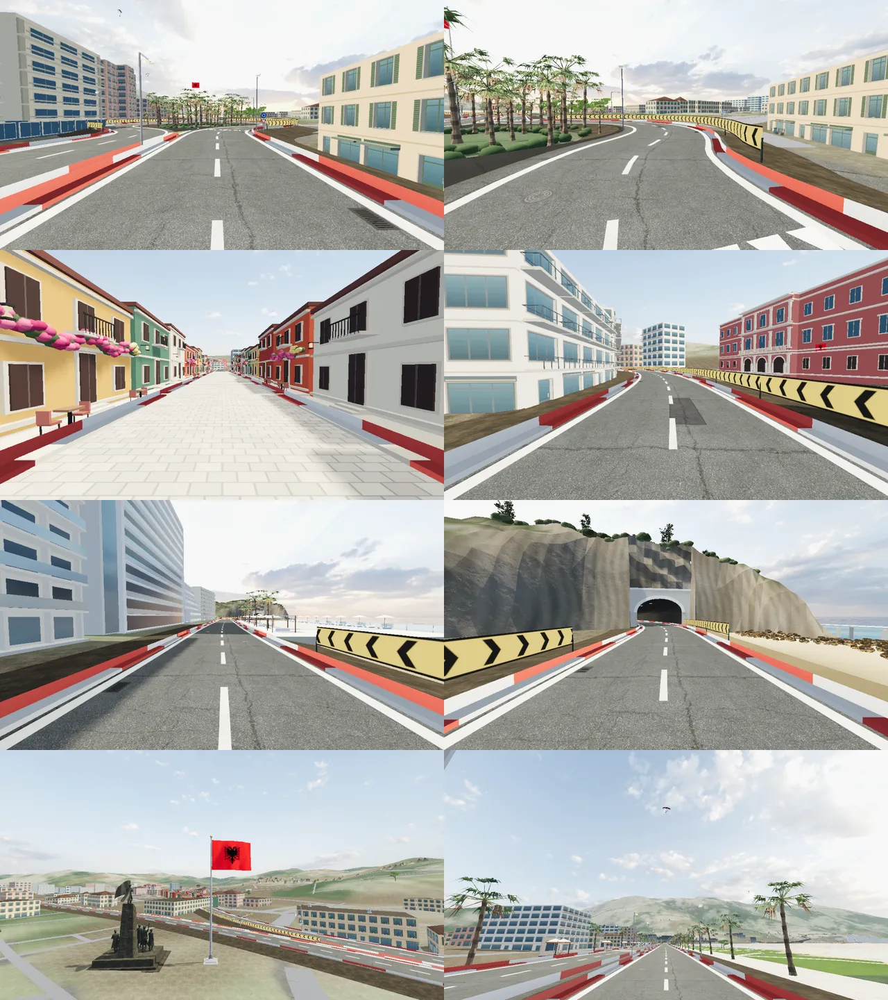

# Vlorë: the out-and-back road and the sea




## The circuit

Vlorë is now raced out and back on the seafront road, like the real
boulevard: **two one-way carriageways of two lanes, 9 m each, 3 m of divider
between them** (centrelines 6 m either side of the mapped road). Lap
≈ 9.5 km:

1. **Out** (right-hand carriageway, the sea side): from the line on
   Bulevardi Ismail Qemali, 100 m before Kuzum Baba, south past Petro Marko
   and Flamurtari stadium, **round the west side of the Sheshi Pavarsia
   island**, past the Independence Museum and down Lungomare and Rruga Murat
   Tërbaçi.
2. **Far loop** (one way): on past the waterfront sports courts and their
   rock-armoured shore, through the Uji i Ftohtë tunnel, the turnaround, and
   back north up **Dhimitër Konomi**.
3. **Merge**: Dhimitër Konomi joins the shore road's return carriageway on a
   40 m-radius bend (no hairpin; the outbound carriageway is ≥ 13 m away all
   through it).
4. **Back** (the land-side carriageway): north the same way, **round the
   east side of Sheshi Pavarsia**, past the stadium and Kuzum Baba, the
   Muradie Mosque, and **round the turning island on Sheshi i Flamurit** into
   the outbound carriageway and the line.

The old-town return (town hall, stone street, Muradie street, Lungomare
median) is gone from the lap: the road focus is the boulevard and seafront.

## How it is built (`tools/pipeline/build_city.py`, `cities.py` `out_and_back`)

- `shared` waypoints: the mapped road both legs use, Flag Square island →
  the merge point on Rruga Murat Tërbaçi (an OSM carriageway node, not the
  promenade footway beside it). Each leg is offset `offset` m to its side;
  near each roundabout in `roundabouts` the offset swells (cosine, over 2.4 ×
  the ring radius) so the legs go round the island.
- `loop` waypoints: an **open** path from the merge round the far end to the
  last stretch of Dhimitër Konomi. `_merge_join` cuts it short of the
  junction if it would come within a road width + 2.5 m of the outbound
  carriageway, then fits run-in, circular arc (either hand, widest radius
  ≤ 40 m that clears) and run-out into the return carriageway.
- `check_carriageways_apart` fails the build if, after bend smoothing, any two
  parts of the lap more than 50 m apart along it come within two half widths
  + 0.5 m: the passes never share tarmac.
- Roundabout islands (`'island': radius` on a landmark) are baked into
  `props.json` capped to the road as built (kerb 0.8 m off the road edge):
  Sheshi Pavarsia 18.1 m, Flag Square 7.3 m.
- `track.json` carries `lanes: 2` and `one_way: true`; the road shader then
  draws one dashed lane line and no yellow centre line (`RoadMesh.set_layout`).
- The finish (`finish_line.py`) and the seafront dressing (`seafront.py`) use
  the lap's **first** pass by their anchor, so the line stays on the
  outbound carriageway and the café terraces and land-side palms stand beyond
  the return carriageway.
- The simulation keeps working at half width 4.5 m: grid columns, pit/station
  lanes, respawn clamp and shock-dome lanes scale with it (`race.gd`;
  unchanged for the other cities).

Rebuild (Overpass mirrors refuse or time out from some networks;
`VORTEX_OSM_API=1` makes street furniture use the main OSM API):

```sh
python3 tools/pipeline/fetch_osm.py vlore     # falls back to the OSM API
VORTEX_OSM_API=1 python3 tools/pipeline/build_city.py vlore
```

## The sea by the sports courts

After the photographs of that shore at night:

- **Rock armour** (`scripts/world/sea_rocks.gd`, `shaders/sea_rock.gdshader`):
  angular ochre and grey limestone boulders piled from 1.6 m out in the water
  up the bank (to 3 m above the sea, at most 9 m in), two layers over the
  toe; ~11 000 stones along the waterline within 140 m of the race road,
  420 m either side of the courts. The waterline is traced from the baked
  water mask, then walked inland to where the bank actually leaves the water
  (the mask's line sits on the dropped seabed). Stones are darker, glossier
  and algae-tinted up to 0.9 m above the water; rain wets them all.
- **Water** (`shaders/sea.gdshader`): green-teal near the shore and on wave
  faces turned to the viewer; a warped Voronoi **lace** of foam that forms
  behind each set of waves, thins seaward and drifts in rafts; a broken
  white wash where the surge meets the shore.
- **Spray**: a pool of three particle bursts thrown up off the outer stones
  18–120 m from the camera, every 0.45–1.1 s. Off on Low and under
  performance pressure (`fx_extras`).

### Cost

Fixed camera on the rocks (the worst case), Mobile renderer, 1280×720
(lavapipe; primitive counts are device-independent):

| | Medium | Low |
|---|---|---|
| Without rocks | 486 k triangles, 175 draws | 484 k, 172 |
| With rocks | 634 k (+148 k), 204 draws | 564 k (+81 k), 200 |
| Chase camera on the grid | unchanged (587 k) | unchanged |

Per 96 m chunk and stone shape there are two MultiMeshes: 56-triangle stones
within 75 m of the chunk centre, 30-triangle ones to 420 m. Low and pressure
stage ≥ 2 draw 55% of the stones (shuffled, so the pile thins evenly). No
shadows, one material. The lace is evaluated only within 22 m of the shore
and 260 m of the camera.

Not verified on a phone: frame time at the seafront on the target devices.

## Tests

- `tests/city_worlds` (Vlorë): one-way two-lane layout, 9 m carriageways,
  landmarks passed out and back in order, courts once on the far loop,
  tunnel → turnaround order, Muradie → Flag Square turn → Muradie → line,
  carriageways never closer than a divider, islands clear of the road.
- `tests/vlore_kuzum_baba`: the line on the first (outbound) pass.
- `tests/sea_rocks`: stones along the waterline, off the road, near the
  courts; both LODs; thinner on Low; spray only when `fx_extras`.
- `tools/pipeline/test_out_and_back.py`: merge join (shallow merge kept
  whole, converging road cut back, impossible merge refused), carriageway
  gate, first-pass seafront.
