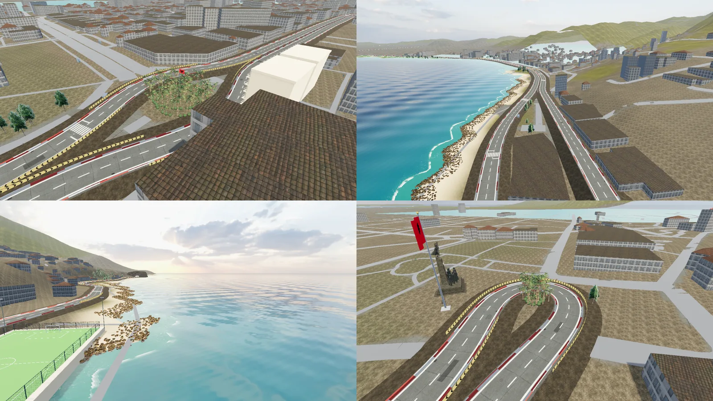

# Vlorë: the out-and-back road and the sea




## The circuit

Vlorë is raced out and back on the seafront road, like the real
boulevard: **two one-way carriageways of two lanes, 9 m each, 3 m of divider
between them** (centrelines 6 m either side of the mapped road). Lap
≈ 10.6 km:

1. **Out** (right-hand carriageway, the sea side): from the line on
   Bulevardi Ismail Qemali, 100 m before Kuzum Baba, south past Petro Marko
   and Flamurtari stadium, **round the west side of the Sheshi Pavarsia
   roundabout**, past the Independence Museum and down Lungomare and Rruga
   Murat Tërbaçi.
2. **Far loop** (one way): on past the waterfront sports courts and their
   rock-armoured shore, the hotels and beach club, through the Uji i Ftohtë
   tunnel, the turnaround, and back north up **Dhimitër Konomi**.
3. **Merge**: Dhimitër Konomi joins the shore road's return carriageway on a
   40 m-radius bend (no hairpin; the outbound carriageway is ≥ 13 m away all
   through it).
4. **Back** (the land-side carriageway): north the same way, **round the
   east side of the roundabout**, past the stadium, Kuzum Baba and the
   Muradie Mosque.
5. **Near loop** (one way, 1.26 km): off the boulevard by Sheshi i Flamurit,
   straight up through old Muradie on stone setts (Justin Godard), on north
   with **the Bashkia on the right**, left across the top and straight back
   down Rruga Demokracia onto the square, past the Independence Monument and
   the great flag, into the outbound carriageway and the line. Four bends,
   the tightest about 59 m in radius.

### Sheshi Pavarsia, a roundabout

Each pass leaves its carriageway on a right-hand entry curve (22 m radius),
circles the island on the ring (25 m, on the mapped ring) for about 105° and
leaves on a right-hand exit curve: right, left, right, so every car has to
brake. The geometry is spliced in after the lap is smoothed
(`roundabout_pass`, `shape_roundabouts`); smoothing first would pull the
ring ~18% in toward the island.

`track.json` carries `roundabouts` ([x, z, ring, entry]) and `slow`
([x, z, radius, km/h]). `RaceTrack.slow_zones` turns each into the stretches
of lap within the radius; the AI's speed planner brakes to 55 km/h for them
(`RaceTrack.slow_speed`, `race.gd ai_drive`). `RoundaboutRing` dresses it:
the circulating carriageway paved all the way round with its dashed lane
line, kerbed splitter islands where each entry and exit part, give-way
teeth across each entry, and the blue roundabout and give-way signs. The
race road leaves its island-side kerb, barrier and chevrons out within the
ring (`RoadMesh.open_edges`).

## How it is built (`tools/pipeline/build_city.py`, `cities.py` `out_and_back`)

- `shared` waypoints: the mapped road both legs use, Sheshi i Flamurit →
  the merge point on Rruga Murat Tërbaçi (an OSM carriageway node, not the
  promenade footway beside it). Each leg is offset `offset` m to its side;
  the roundabout's mapped ring is replaced by a line through its centre,
  and `shape_roundabouts` swings each pass round the island afterwards.
- `near_loop` control points: a centripetal Catmull-Rom from the end of the
  return carriageway to the start of the outbound one, after the streets
  it follows. `stone_street` marks its Muradie stretch (setts and low
  plaster fronts, `muradie_street.gd`); `infill` fills the frontage the map
  leaves empty along it with plain 4-7 storey blocks (`infill_planner`,
  skipped wherever they would touch a mapped building, a keepout, the water
  or another part of the lap).
- `loop` waypoints: an **open** path from the merge round the far end to the
  last stretch of Dhimitër Konomi. `_merge_join` cuts it short of the
  junction if it would come within a road width + 2.5 m of the outbound
  carriageway, then fits run-in, circular arc (either hand, widest radius
  ≤ 40 m that clears) and run-out into the return carriageway.
- `check_carriageways_apart` fails the build if, after bend smoothing, any two
  parts of the lap more than 50 m apart along it come within two half widths
  + 0.5 m: the passes never share tarmac.
- The roundabout island (`'island': radius` on a landmark) is baked into
  `props.json` capped to the road as built (kerb 0.8 m off the road edge):
  Sheshi Pavarsia 19.7 m.
- `sea_clear`: from the Independence Museum along Lungomare and the shore
  road to the tunnel, no building stands between the road and the sea
  (`sea_side_clearance`: the sea side is probed per sample on the water
  mask; a footprint wholly on that side within 300 m goes).
- `resort` (`vlore_resort.py`): 60–380 m before the north portal, two rows
  of hotels on the land side (the front row on the road, a second stepped
  up the hillside, a 12-storey glass tower among them) and a beach club on
  the sea side 170 m before it, its deck from the road edge to the shore.
  Their rectangles are kept clear of mapped buildings, trees, street
  furniture and ground cover.
- `track.json` carries `lanes: 2` and `one_way: true`; the road shader then
  draws one dashed lane line and no yellow centre line (`RoadMesh.set_layout`).
- The finish (`finish_line.py`) and the seafront dressing (`seafront.py`) use
  the lap's **first** pass by their anchor, so the line stays on the
  outbound carriageway and the café terraces and land-side palms stand beyond
  the return carriageway.
- The simulation keeps working at half width 4.5 m: grid columns, pit/station
  lanes, respawn clamp and shock-dome lanes scale with it (`race.gd`;
  unchanged for the other cities).

Rebuild (Overpass mirrors refuse or time out from some networks;
`VORTEX_OSM_API=1` makes street furniture use the main OSM API):

```sh
python3 tools/pipeline/fetch_osm.py vlore     # falls back to the OSM API
VORTEX_OSM_API=1 python3 tools/pipeline/build_city.py vlore
```

## Before the tunnel: hotels, the beach club, the headland

After photographs from the bay and the beach:

- **Hotels** (`VloreResort`, `scripts/world/vlore_resort.gd`): white blocks
  whose upper floors step back into terraces behind glass balustrades and
  white fins, a glass-fronted tower with a lift shaft, cream slabs with
  continuous balconies. Foundations run into the slope. One mesh for the
  walls, one for the glazing.
- **Beach club**: a stone deck from the road edge to the shore, a 62 × 16 m
  pool along it, white loungers in pairs on both sides under parasols,
  cabanas and palms along the road side, steps down the sea face. Rock
  armour lines the shore in front of it (`SeaRocks.CLUB_REACH`).
- **The headland** (`scripts/world/vlore_tunnel.gd`,
  `shaders/headland_rock.gdshader`): the road runs through a limestone
  promontory that drops from the hillside into the bay: a cross-section
  every 2 m with a crest ~20 m over the bore, a steep seaward cliff and a
  back that runs into the hillside, never below the terrain under it.
  Beside each approach the rock dies away within a few metres of the road
  and over 20–44 m further out, so each portal stands in a rock face across
  the road. A concrete headwall with a projecting arch ring and coping
  fills each portal; the rock above it steps in ledges. Faceted grey
  limestone with ochre stains, dark fractures and vertical weathering
  streaks (triplanar relief from the rock photograph, its colour
  discarded); maquis on the gentler ground and a few pines on the crest; a
  pier walk on pillars round the seaward cliff's foot.

### Cost (triangles, counted from the built meshes)

| | Low | Medium | High |
|---|---|---|---|
| Headland rock, headwalls, bore, pier | 18 k | 18 k | 18 k |
| Maquis on the headland (thinned by `tree_mul`) | 15 k | 26 k | 44 k |
| Pines on the crest (2 / 4 / 6) | 11 k | 23 k | 34 k |
| Hotels and beach club | 23 k | 23 k | 23 k |
| Roundabout dressing | 0.7 k | 0.7 k | 0.7 k |

Not measured on a phone: frame time approaching the tunnel past the hotels.

## Flag Square and the sky

- **The great flag** (`Landmarks._great_flag`, `shaders/flag_cloth.gdshader`):
  an 11.2 × 8 m flag (5:7) on a 32 m tapered mast with a stepped plinth,
  finial and halyard. The eagle is the state's vector drawing (public
  domain), rasterised once (`tools/build_albanian_flag.py`). The cloth
  ripples from the hoist in three travelling folds that grow toward the fly,
  gusting every few seconds; the fly droops, folded cloth takes up its
  width, and the normal follows the folds so they catch the light. The
  Bashkia's and the roundabout's flags use the same cloth.
- **Paragliders** (`Paragliders`, landmark `lungomare_paragliders`): six
  wings of coloured cells with lines and a seated pilot, 85–165 m up over
  Lungomare and the shore road, each circling its own thermal and banked
  into the turn.

## The sea by the sports courts

After the photographs of that shore at night:

- **Rock armour** (`scripts/world/sea_rocks.gd`, `shaders/sea_rock.gdshader`):
  angular ochre and grey limestone boulders piled from 1.6 m out in the water
  up the bank (to 3 m above the sea, at most 9 m in), two layers over the
  toe; ~11 000 stones along the waterline within 140 m of the race road,
  420 m either side of the courts. The waterline is traced from the baked
  water mask, then walked inland to where the bank actually leaves the water
  (the mask's line sits on the dropped seabed). Stones are darker, glossier
  and algae-tinted up to 0.9 m above the water; rain wets them all.
- **Water** (`shaders/sea.gdshader`): green-teal near the shore and on wave
  faces turned to the viewer; a warped Voronoi **lace** of foam that forms
  behind each set of waves, thins seaward and drifts in rafts; a broken
  white wash where the surge meets the shore.
- **Spray**: a pool of three particle bursts thrown up off the outer stones
  18–120 m from the camera, every 0.45–1.1 s. Off on Low and under
  performance pressure (`fx_extras`).

### Cost

Fixed camera on the rocks (the worst case), Mobile renderer, 1280×720
(lavapipe; primitive counts are device-independent):

| | Medium | Low |
|---|---|---|
| Without rocks | 486 k triangles, 175 draws | 484 k, 172 |
| With rocks | 634 k (+148 k), 204 draws | 564 k (+81 k), 200 |
| Chase camera on the grid | unchanged (587 k) | unchanged |

Per 96 m chunk and stone shape there are two MultiMeshes: 56-triangle stones
within 75 m of the chunk centre, 30-triangle ones to 420 m. Low and pressure
stage ≥ 2 draw 55% of the stones (shuffled, so the pile thins evenly). No
shadows, one material. The lace is evaluated only within 22 m of the shore
and 260 m of the camera.

Not verified on a phone: frame time at the seafront on the target devices.

## Tests

- `tests/city_worlds` (Vlorë): one-way two-lane layout, 9 m carriageways,
  landmarks passed out and back in order, courts once on the far loop,
  tunnel → turnaround order, Muradie Mosque → Bashkia (on the right, by the
  road) → Flag Square → Muradie Mosque → line, the near loop's bends no
  tighter than 30 m, both passes on the roundabout's ring with its paving,
  splitters and open island edge, the field's 55 km/h there, carriageways
  never closer than a divider, the island clear of the road; hotels back
  from the road before the tunnel, the beach club over the sea; the great
  flag's 5:7 eagle; paragliders high, moving and in sight of the road.
- `tests/vlore_kuzum_baba`: the line on the first (outbound) pass.
- `tests/sea_rocks`: stones along the waterline, off the road, near the
  courts; both LODs; thinner on Low; spray only when `fx_extras`.
- `tools/pipeline/test_out_and_back.py`: merge join (shallow merge kept
  whole, converging road cut back, impossible merge refused), carriageway
  gate, first-pass seafront, a roundabout pass on the ring (never inside it,
  continuous, island on the left only), sea-side clearance.
- `tools/pipeline/test_vlore_resort.py`: hotels and club face the road.
- `tests/vlore_views` renders any list of views (`--views=` JSON,
  `--out=` directory) for review.
