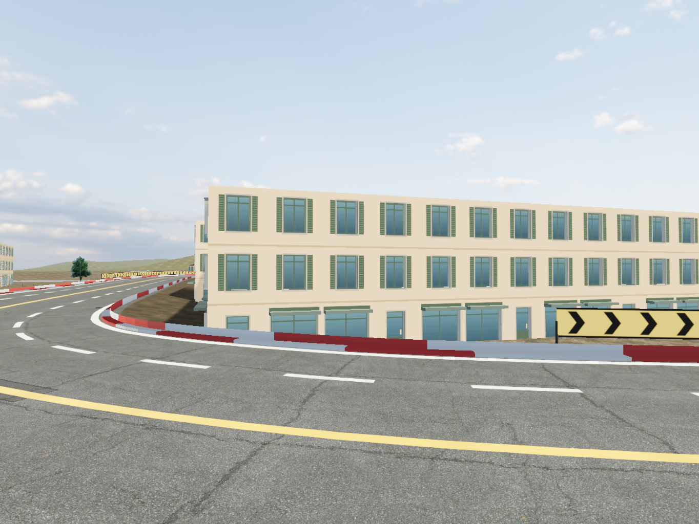
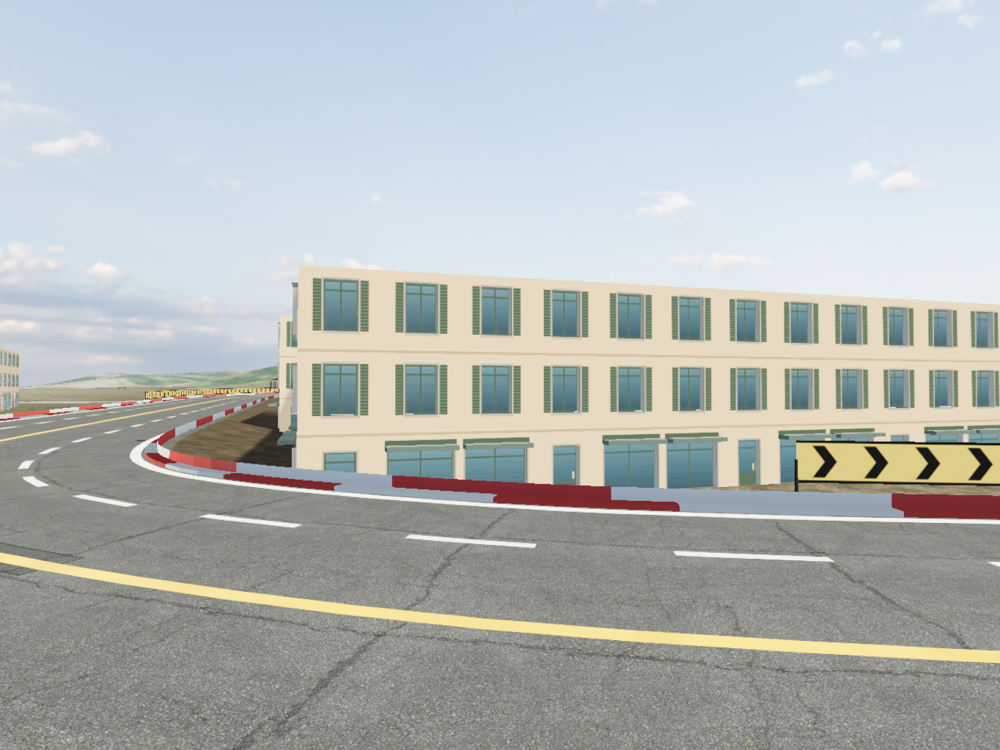
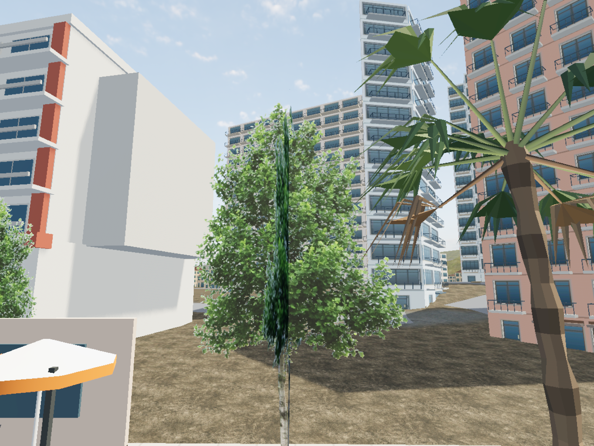
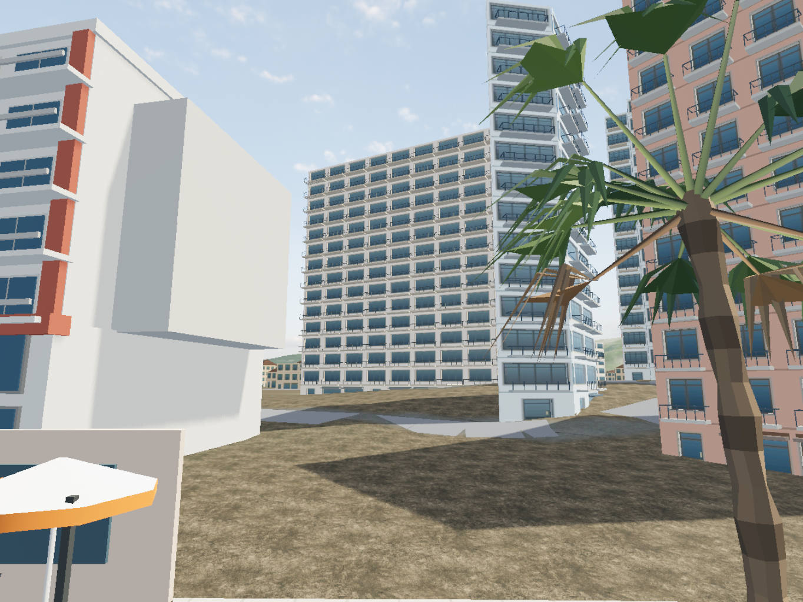
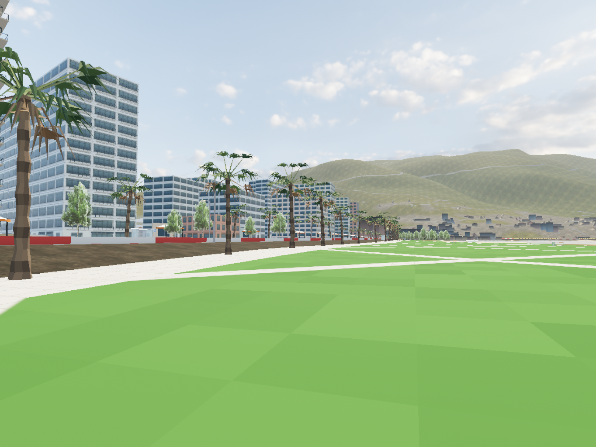
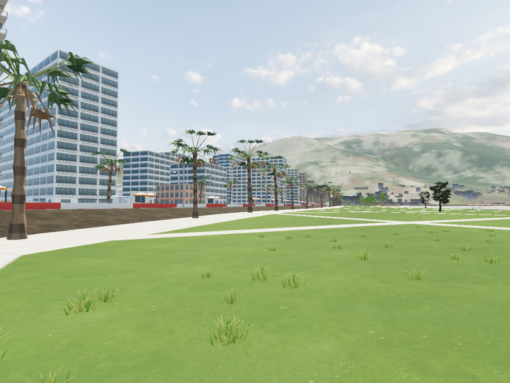
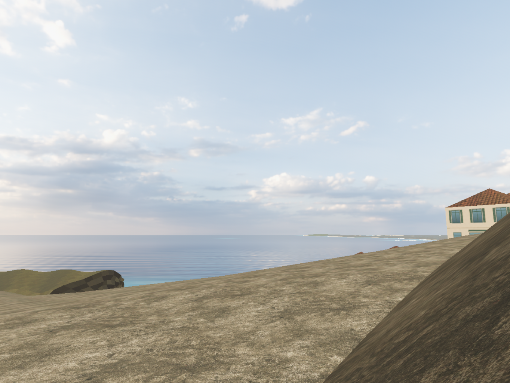
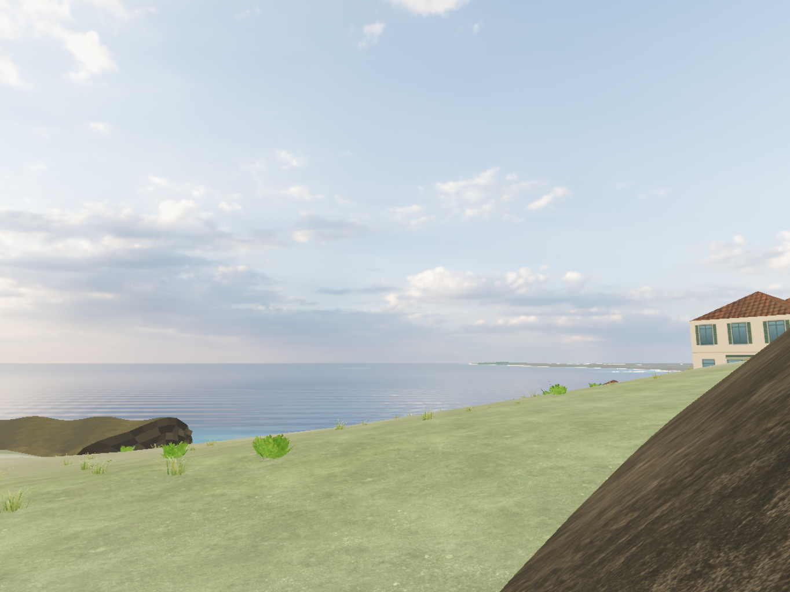
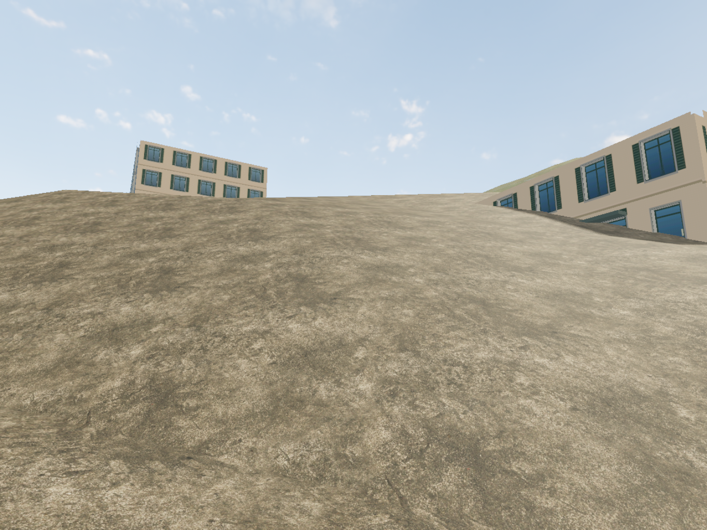
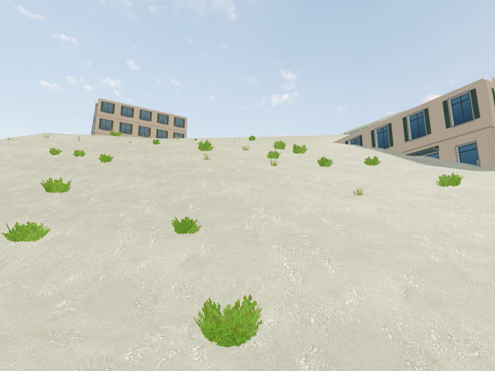

# Vlorë coastal terrain and vegetation

Five fixed daylight cameras compare baseline `785cd13` with the vegetation changes on Godot 4.4.1 Mobile, Medium quality, Vulkan llvmpipe, 1364 × 1024. Flag Square and Lungomare reuse the architecture comparison cameras. Both revisions used the same capture scene and frame count. The lossless images preserve the rendered pixels.

| Camera | Before | After |
| --- | --- | --- |
| Flag Square |  |  |
| Lungomare |  |  |
| Promenade lawn |  |  |
| Coastal hillside |  |  |
| Hillside scrub |  |  |

## Render profile

Draws and primitives are engine counters for the full frame. The two cover columns count enabled instances in range- and frustum-intersecting MultiMesh batches. Some instances in those batches shrink to zero at the tier boundaries. Baseline ground-cover counts were zero. Tree centres count mapped broadleaf crowns inside the camera frustum before occlusion and renderer range culling.

| View | Draws before → after | Primitives before → after | Near cover | Middle cover | Tree centres before → after |
| --- | ---: | ---: | ---: | ---: | ---: |
| Flag Square | 94 → 95 | 470,186 → 469,688 | 0 | 18 | 1 → 0 |
| Lungomare | 178 → 179 | 674,427 → 674,041 | 0 | 0 | 358 → 219 |
| Promenade lawn | 168 → 177 | 608,841 → 643,148 | 383 | 208 | 121 → 107 |
| Coastal hillside | 108 → 116 | 380,176 → 391,767 | 186 | 132 | 402 → 295 |
| Hillside scrub | 145 → 164 | 383,117 → 401,619 | 364 | 134 | 24 → 57 |

Medium enables seven coastal pines alongside the 99 promenade palms. Across the whole city, Low, Medium and High enable 12,837, 22,006 and 36,658 ground-cover tier instances respectively. These totals include both representations of a plant where applicable. The pine counts are four, seven and eleven. The software Vulkan runs measure submission costs. Handset frame time and thermal behaviour remain unmeasured.

## Placement and regeneration

The Vlorë bake uses the projected roofs, rendered side-road triangles, the race skirt, coastline grid, café and landmark clearances, and promenade ribbons. Lawn seeds follow the rendered triangles and avoid both diagonal path families. The deterministic placement buffer holds 16,700 natural tufts, 8,626 brush plants, 3,149 lawn tufts and 11 pine sites. The original mapped tree list is retained alongside its exclusions.

Ground cover shares four meshes across 64 m spatial cells. Close tufts and shrub sprays give way to a sparser tier over 21–27 m. That tier tapers out over 67–80 m. The terrain material continues the soil, limestone, grass and scrub variation into the distance. Vlorë street trees reuse Tirana’s camera-driven canopy pools and impostors. Shrubs share its compressed leaf atlas. Adaptive pressure reduces density and wind.

Run from the repository root with the pipeline dependencies installed.

```sh
python tools/pipeline/coastal_macro.py
python tools/pipeline/coastal_vegetation.py
godot --headless --path godot --import
godot --path godot --rendering-method mobile --fixed-fps 60 --audio-driver Dummy res://tests/vlore_vegetation_visual.tscn
```

The scene writes PNGs to `user://vegetation/` and prints a `VEGETATION` profile for each view. Pass `-- quality=low` or `-- quality=high` to capture another preset.
